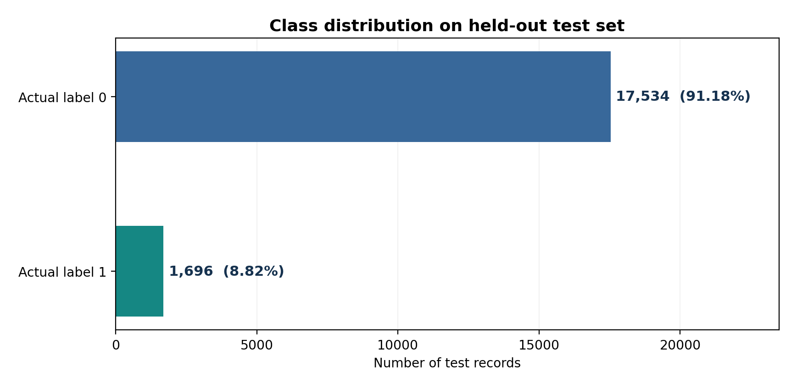
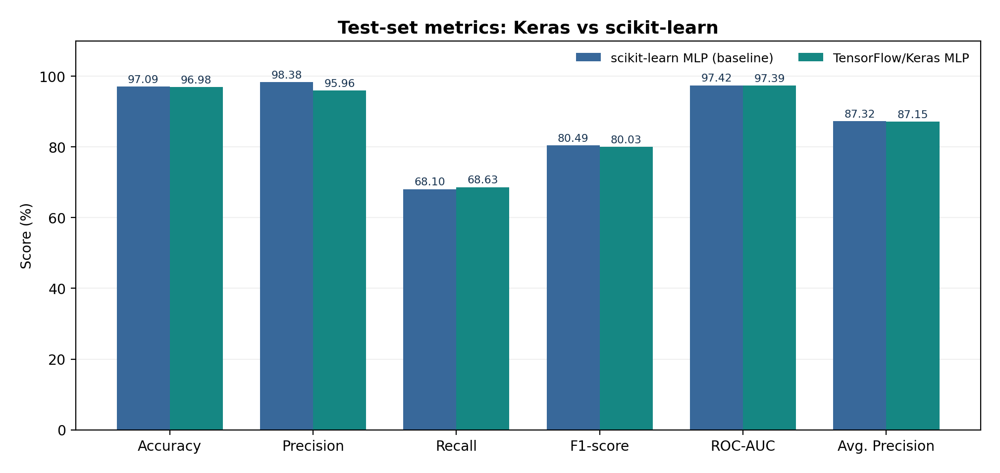
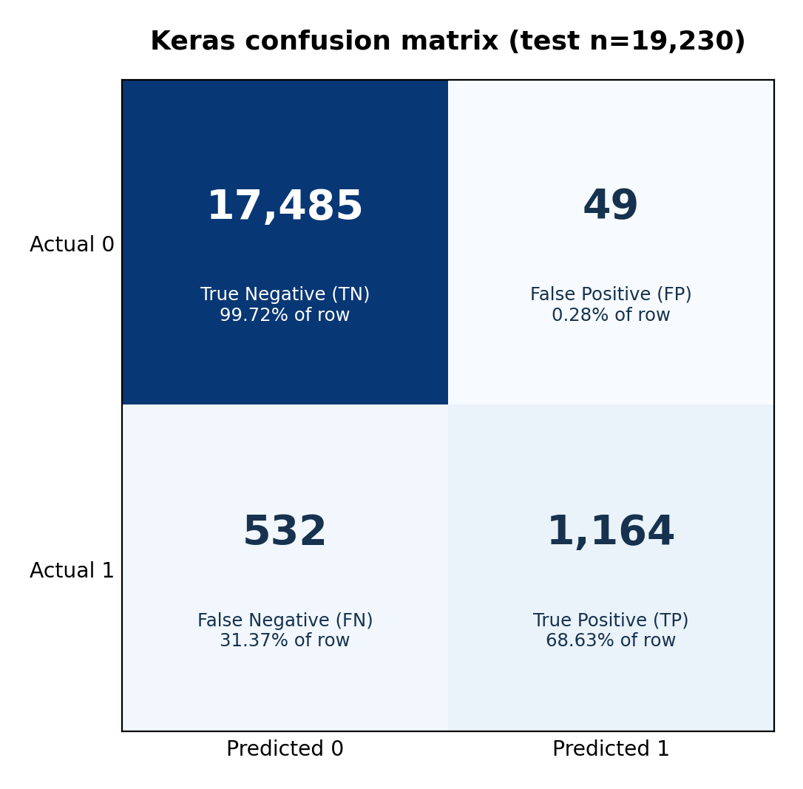
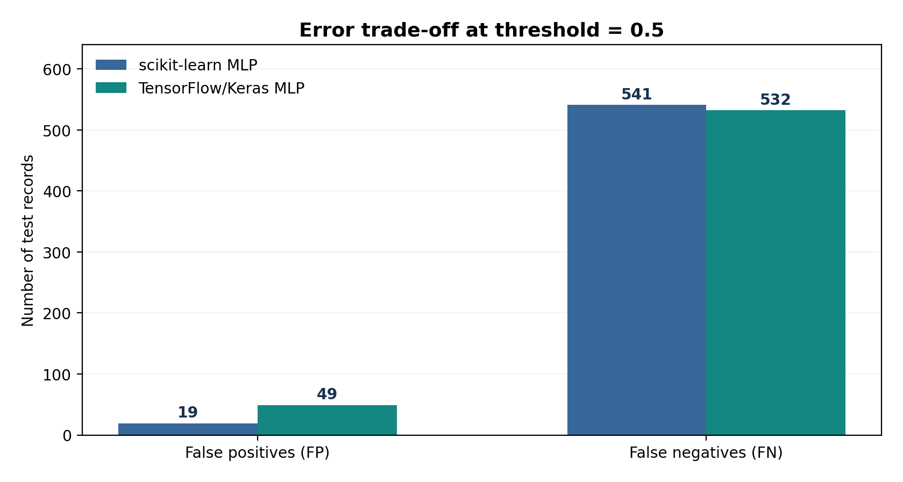

# DL-K3 — ĐÁNH GIÁ MÔ HÌNH DEEP LEARNING TENSORFLOW/KERAS

**Hệ đa Agent cho bệnh tiểu đường · Báo cáo cuối môn Phát triển các hệ thống thông minh**  
**Mô hình chính:** `diabetes_keras_v1` · **Đối chứng/rollback:** `diabetes_mlp_v1`  
**Phạm vi:** thực nghiệm phân loại nhãn trên bộ dữ liệu công khai. Không phải hệ thống chẩn đoán y khoa.

## 1. Mục tiêu và vai trò trong hệ Multi-Agent

DL Prediction Agent đảm nhiệm phân loại nhị phân trên bộ dữ liệu mẫu và trả nhãn `prediction`, điểm mô hình `model_score_class_1` (chưa hiệu chuẩn), `model_version` và các thông tin về schema. Kết quả được chuyển tiếp tới Coordinator và được các Agent khác sử dụng theo vai trò riêng. DL-K2 đã cho phép chọn model chính TensorFlow/Keras bằng `DL_MODEL_BACKEND=keras`, và chọn lại scikit-learn bằng `DL_MODEL_BACKEND=sklearn`, không thay đổi hợp đồng API.

## 2. Bộ dữ liệu và tiền xử lý

Nguồn dữ liệu: *Diabetes Prediction Dataset* được mô tả trong `data/raw/README.md` của project. Sau loại các dòng trùng hoàn toàn, quy trình DL-K1 dùng tách train/test phân tầng 80/20 với seed=42. Trong phần train tiếp tục tách 10% cho validation.

| Thành phần | Số mẫu |
|---|---:|
| Train tổng | 76.916 |
| Train để fit mô hình | 69.224 |
| Validation | 7.692 |
| Test giữ độc lập | 19.230 |
| Test — nhãn 0 | 17.534 |
| Test — nhãn 1 | 1.696 |

**8 đặc trưng đầu vào:** `gender`, `age`, `hypertension`, `heart_disease`, `smoking_history`, `bmi`, `HbA1c_level`, `blood_glucose_level`. Dữ liệu sau `StandardScaler` cho biến số và `OneHotEncoder` cho biến phân loại có **15 chiều**. Bộ tiền xử lý chỉ được *fit* trên tập fit; validation và test chỉ được *transform*, tránh rò rỉ thông tin từ hai tập này vào bước chuẩn hóa.

## 3. Kiến trúc và huấn luyện

- Framework: **TensorFlow/Keras**; mạng MLP truyền thẳng gồm `Input(15) → Dense(64, ReLU) → Dense(32, ReLU) → Dense(1, sigmoid)`.
- Loss: `binary_crossentropy`; optimizer: Adam với learning rate 0,001; batch size mặc định 256.
- `EarlyStopping(monitor='val_loss', patience=8, restore_best_weights=True)`; quá trình thực tế ghi nhận **27 epochs**.
- Ngưỡng phân loại **0,5**; không tối ưu ngưỡng bằng test. Tách test độc lập để báo cáo hiệu năng.
- Artifact: `models/keras_dlk1/diabetes_keras_v1.keras`; preprocessor: `models/keras_dlk1/preprocessor.joblib`; manifest: `outputs/keras_dlk1/experiment_manifest.json`. Backend DL-K2 kiểm tra SHA256 và schema trước khi nạp.

**Phân biệt điểm mô hình và xác suất:** Giá trị sigmoid là điểm số lớp 1 chưa được hiệu chuẩn; không được mô tả như xác suất mắc bệnh có giá trị lâm sàng. Nhãn 0/1 phản ánh nhãn trong dataset, không khẳng định chẩn đoán.

## 4. Kết quả kiểm thử và so sánh

| Chỉ số | TensorFlow/Keras | scikit-learn | Chênh lệch (Keras − cũ) |
|---|---:|---:|---:|
| Accuracy | 96,98% | 97,09% | -0,11 điểm % |
| Precision (class 1) | 95,96% | 98,38% | -2,42 điểm % |
| Recall (class 1) | 68,63% | 68,10% | +0,53 điểm % |
| F1-score (class 1) | 80,03% | 80,49% | -0,46 điểm % |
| ROC-AUC | 97,39% | 97,42% | -0,03 điểm % |
| Average Precision | 87,15% | 87,32% | -0,17 điểm % |

**Nhận xét:** Accuracy của Keras là **96,98%**, thấp hơn scikit-learn khoảng **0.11 điểm phần trăm**. Recall lớp 1 tăng khoảng **0.53 điểm phần trăm**, nhưng Precision và F1-score thấp hơn. Hai mô hình có chất lượng gần nhau trong tập test cụ thể; không có cơ sở khẳng định một mô hình vượt trội chung hoặc có khả năng chẩn đoán thực tế.

## 5. Confusion Matrix và phân tích sai số

Confusion Matrix theo quy ước **hàng = nhãn thật**, **cột = nhãn dự đoán**:

| Keras | Dự đoán 0 | Dự đoán 1 |
|---|---:|---:|
| Thực tế 0 | **17,485 (TN)** | **49 (FP)** |
| Thực tế 1 | **532 (FN)** | **1,164 (TP)** |

- **TN = 17,485**: mẫu lớp 0 được dự đoán đúng.
- **TP = 1,164**: mẫu lớp 1 được dự đoán đúng.
- **FP = 49**: mẫu lớp 0 được dự đoán nhầm thành lớp 1.
- **FN = 532**: mẫu lớp 1 bị dự đoán nhầm thành lớp 0, tương đương **31.37%** tổng số mẫu lớp 1 trên tập test.
- So với scikit-learn cũ, Keras tăng **9 TP**, tăng **30 FP**, giảm **9 FN** ở ngưỡng 0,5.

**Vì sao không chỉ nhìn Accuracy?** Trong tập test, nhãn 1 chiếm khoảng **8.82%**; mô hình luôn đoán nhãn 0 vẫn đạt Accuracy khoảng **91.18%**. Vì vậy cần trình bày Recall, Precision, F1-score và Average Precision bên cạnh Accuracy.

## 6. Đánh giá ưu điểm và giới hạn

**Ưu điểm:** (i) triển khai Neural Network bằng TensorFlow/Keras đúng framework yêu cầu; (ii) có validation riêng, early stopping và artifact để nạp lại; (iii) hợp đồng API ổn định trong hệ Multi-Agent; (iv) có baseline scikit-learn và cơ chế rollback bằng cấu hình.

**Giới hạn:** (i) Recall lớp 1 **68,63%**, còn 532 FN; (ii) dữ liệu có mất cân bằng lớp; (iii) chỉ loại bản ghi trùng hoàn toàn, chưa xác minh được các bản ghi khác nhau của cùng cá nhân; (iv) điểm sigmoid chưa hiệu chuẩn; (v) chưa kiểm chứng ngoại bộ hay giá trị chẩn đoán lâm sàng. Không sử dụng hệ thống để tư vấn điều trị hoặc đưa ra chẩn đoán.

**Tránh diễn giải sai:** Chúng tôi không dựng đường ROC, PR hoặc loss-curve từ các metric tổng hợp. Biểu đồ loss thật của DL-K1, nếu cần chèn thêm, lấy trực tiếp từ `outputs/keras_dlk1/keras_training_loss.png` trên máy đã huấn luyện. Chỉ vẽ khi có dữ liệu huấn luyện thực tế.

## 7. Tích hợp Keras vào Backend và quản lý phiên bản

- `DL_MODEL_BACKEND=keras` → nạp `diabetes_keras_v1.keras` và `preprocessor.joblib`; `DL_MODEL_BACKEND=sklearn` → nạp `diabetes_mlp_v1.joblib`.
- Service kiểm tra schema 8 trường, manifest/SHA256 và trả `model_version` trong payload. Không có fallback tự động khi backend được chọn bị lỗi.
- Các Agent khác và React không phải sửa; kiểm tra runtime qua `python backend/scripts/dl_k2_check.py --backend keras`, `/api/predict` và `/api/assess`.
- Phiên bản dữ liệu/hyperparameters được ghi trong manifest và code DL-K1; không đẩy file model, `.env`, dataset tải về hoặc SQLite lên GitHub.

## 8. Nguồn số liệu và khả năng tái lập

Số liệu báo cáo lấy từ hai file người thực hiện đã cung cấp: `outputs/keras_dlk1/metrics.json`, `outputs/keras_dlk1/comparison_report.md` và số liệu đối chứng `outputs/dl_training_metrics.json`. Các bản snapshot chỉ gồm metric tổng hợp được kèm tại `docs/reports/keras_metrics_dl_k1.json`, `docs/reports/sklearn_metrics_baseline.json` để đối chiếu, **không phải lần huấn luyện mới**. Cùng SHA256 dataset/seed/outer split đã được DL-K1 báo cáo, nhưng không có raw prediction vectors để tái dựng ROC/PR curves.

Tham khảo tài liệu triển khai TensorFlow: https://www.tensorflow.org/install/pip ; mô tả dataset: `data/raw/README.md`; hướng dẫn kỹ thuật: `docs/DL_K3_HUONG_DAN_GITHUB.md`.

**Kết luận:** Mô hình `diabetes_keras_v1` đáp ứng mục tiêu minh họa thành phần Deep Learning trong hệ Multi-Agent học thuật. Hiệu năng gần tương đương baseline scikit-learn; cần minh bạch điểm yếu Recall và không suy diễn sang độ tin cậy y khoa.
