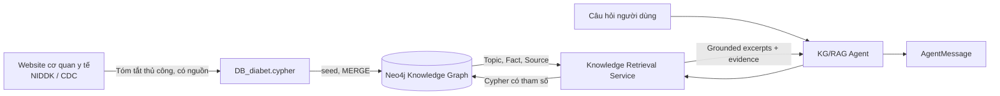

# GIAI ĐOẠN 2 — Neo4j Knowledge Graph + KG/RAG Agent

**Project:** Hệ đa Agent hỗ trợ ra quyết định về bệnh tiểu đường  
**Môn:** Phát triển các hệ thống thông minh (PTIT)  
**Trạng thái:** Chỉ được nghiệm thu sau khi người học chạy thành công Neo4j thật, tests và API; **chưa chuyển Giai đoạn 3**.

## 0. Nghiệm thu Giai đoạn 1

Người học đã **tự xác nhận** Giai đoạn 1 huấn luyện mô hình, tạo đủ 3 artifacts, chạy unit tests và API `/api/predict` PASS. Chưa đính kèm log, nên đây là nghiệm thu theo xác nhận của người học chứ không phải đánh giá độc lập về metric hay chất lượng model.

**Không xóa và không train lại model Giai đoạn 1**. Giai đoạn 2 bổ sung **KG/RAG Agent** độc lập, phần dự đoán DL giữ nguyên.

## 1. Đối chiếu với kiến trúc giảng viên

PDF `docs/references/project_architecture_multiagent_diabet_v1.pdf`, đặc biệt:

- §2: kiến trúc 6 tầng; Neo4j là thành phần của **Knowledge and Model Layer**.
- §3: **KG/RAG Agent** phụ trách truy xuất kiến thức và nguồn dẫn; không chịu trách nhiệm dự đoán bằng DL hay chẩn đoán.
- §5: khi xây dựng full MAS, **Coordinator Agent** mới gọi KG/RAG Agent cùng các Agent khác.
- §6: mọi Agent cần cấu trúc message: `request_id, agent, status, payload, evidence, version`.
- §7.2: graph retrieval là cốt lõi; truy xuất kho tài liệu bổ sung **nếu có**. Nguồn dẫn phải giữ được.
- §9: Giai đoạn/Phase 2 là tích hợp Neo4j KG/RAG.

**Lưu ý sự khác biệt với PDF:** PDF giả định lớp có sẵn file `DB_diabet.cypher` và Neo4j graph từ bài trước. Bạn bắt đầu hoàn toàn từ đầu nên gói này cung cấp **`data/knowledge/DB_diabet.cypher` mẫu mới do chúng ta tự tạo**, không phải file cũ của giảng viên. Đây là graph tối thiểu, không phải dữ liệu y tế đầy đủ và không đại diện cho kho kiến thức chính thức của giảng viên.

### Kiến trúc dữ liệu Giai đoạn 2



**Đường đi graph:**

```text
(:Topic {id,name,aliases,category})
    -[:HAS_FACT]-> (:Fact {id,text,topic_id})
    -[:SUPPORTED_BY]-> (:Source {id,title,publisher,url})
(:Topic)-[:RELATED_TO]->(:Topic)
```

### Phạm vi KG/RAG của phase này

- Lưu graph thật bằng **Neo4j**; không giả lập dữ liệu trong API.
- Thực thi Cypher có tham số, tìm chủ đề, lấy các Fact liên quan và thông tin Source.
- Dùng xếp hạng từ khóa đơn giản, **không cần embedding/vector DB** cho bài cuối môn.
- Sinh câu trả lời **extractive**, tức ghép nguyên các Fact đã duyệt từ graph và đánh số `[Nguồn 1]`, `[Nguồn 2]`. Mỗi nguồn có URL trong `evidence`.
- Khi không đủ evidence, nói không tìm được thay vì để LLM đoán.
- **Chưa triển khai LLM để tổng hợp**; đó là nhiệm vụ Explanation Agent Giai đoạn 6. Đây là bước retrieval của pipeline RAG, không được mô tả là RAG sinh câu trả lời bằng LLM hoàn chỉnh.
- Không thay DL; `/api/predict` tiếp tục hoạt động như trước. `/api/assess` **vẫn trả 501** vì chưa có Coordinator.

## 2. Cập nhật ZIP, giữ nguyên project cũ

1. Dừng Flask cũ bằng `Ctrl+C`.
2. Sao lưu project nếu đã tự sửa các file được ghi đè.
3. Tải ZIP **`diabetes-multiagent-giai-doan-2-cap-nhat.zip`**.
4. Giải nén vào **thư mục cha đang chứa `diabetes-multiagent`** và cho phép ghi đè file trùng tên. Nếu project ở `D:\PTIT\diabetes-multiagent`, giải nén ở `D:\PTIT`, **không** giải nén vào bên trong `diabetes-multiagent` gây lồng folder.
5. Chắc chắn **không xóa `.venv`, `.env`, `models/diabetes_mlp_v1.joblib`, `config/model_manifest.json`, `outputs/dl_training_metrics.json` và CSV cũ.** ZIP không chứa hay ghi đè các file đó.
6. Mở VS Code ở folder cũ; kiểm tra các file mới `backend/agents/kg_rag_agent.py`, `backend/services/neo4j_service.py`, `backend/scripts/neo4j_cli.py`, `data/knowledge/DB_diabet.cypher`.

## 3. Cài thư viện Neo4j Python

PowerShell ở thư mục root project:

```powershell
.\.venv\Scripts\python.exe -m pip install -r requirements.txt
.\.venv\Scripts\python.exe -c "import neo4j; print('Neo4j driver:', neo4j.__version__)"
```

Dùng driver **`neo4j`** chính thức, không cài `neo4j-driver` (tên cũ).

## 4. Có cơ sở dữ liệu Neo4j hoạt động

### Cách A — Neo4j AuraDB Free (đề xuất, không cần Neo4j Desktop)

1. Vào <https://console.neo4j.io/> và đăng nhập/tạo tài khoản **theo điều kiện sử dụng của dịch vụ**.
2. Tạo một **AuraDB Free** instance (đúng Free, không chọn trả phí). Thông tin và giao diện có thể thay đổi theo thời gian; xem tài liệu: <https://neo4j.com/docs/aura/getting-started/create-instance/>.
3. **Lưu ngay** URI dạng `neo4j+s://<id>.databases.neo4j.io`, username `neo4j` và mật khẩu từ trang tạo instance. Mật khẩu có thể không hiển thị lại.
4. Chờ instance có trạng thái sẵn sàng/Running. Không dùng tính năng vector optimization, Aura Graph Analytics hay chức năng trả phí cho giai đoạn này.
5. **Không đưa dữ liệu cá nhân, bệnh án thật** lên database cloud. Giai đoạn này chỉ nạp tri thức công khai và nguồn dẫn.

AuraDB Free có thể tự pause khi không sử dụng. Nếu gặp lỗi tên miền/kết nối sau vài ngày, vào console xem có cần Resume hay không: <https://neo4j.com/docs/aura/managing-instances/instance-actions/>.

### Cách B — Neo4j cài trên máy

Có thể dùng Neo4j bản chạy local (Neo4j Desktop, Neo4j Community hoặc Docker) nếu đã cài sẵn. Bảo đảm Neo4j đang chạy, Bolt lắng nghe cổng `7687`, và bạn biết password tài khoản `neo4j`. URI thường là `bolt://127.0.0.1:7687`. Chương trình dùng cùng một driver cho cả local/Aura.

### Cấu hình `.env` (RẤT QUAN TRỌNG)

**Không chạy lại `Copy-Item .env.example .env`** vì sẽ đè mất cấu hình Giai đoạn 1. Mở `.env` cũ bằng VS Code và **chỉ sửa hoặc thêm** 4 dòng sau:

**Nếu sử dụng AuraDB Free:**

```dotenv
NEO4J_URI=neo4j+s://YOUR_INSTANCE.databases.neo4j.io
NEO4J_USER=neo4j
NEO4J_PASSWORD=YOUR_PRIVATE_PASSWORD
NEO4J_DATABASE=neo4j
```

**Nếu sử dụng local Neo4j:**

```dotenv
NEO4J_URI=bolt://127.0.0.1:7687
NEO4J_USER=neo4j
NEO4J_PASSWORD=YOUR_PRIVATE_PASSWORD
NEO4J_DATABASE=neo4j
```

Thay `YOUR_INSTANCE`, `YOUR_PRIVATE_PASSWORD` theo thông tin **trên máy của bạn**. Không đặt dấu ngoặc `< >` quanh URI. Không gửi password qua chat, không commit `.env` lên GitHub. Giữ nguyên các dòng `FLASK_*`, `MODEL_MANIFEST_PATH` trước đây.

## 5. Nạp Knowledge Graph mẫu

`data/knowledge/curated_knowledge.json` là bản dữ liệu đọc được, `data/knowledge/DB_diabet.cypher` là script Cypher dùng nạp graph (idempotent nhờ `MERGE` và uniqueness constraints).

Knowledge Graph mẫu gồm:

| Loại | Số lượng dự kiến | Ý nghĩa |
|---|---:|---|
| `Topic` | 8 | tổng quan, phân loại, type 1, type 2, thai kỳ, triệu chứng, xét nghiệm, HbA1c |
| `Fact` | 16 | mệnh đề giáo dục tóm tắt dựa trên nguồn |
| `Source` | 4 | các trang NIDDK/CDC |
| Quan hệ | 39 | Topic—Fact, Fact—Source và Topic—Topic |

Nguồn tham khảo:

- NIDDK Overview: <https://www.niddk.nih.gov/health-information/diabetes/overview>
- NIDDK Tests & Diagnosis: <https://www.niddk.nih.gov/health-information/diabetes/overview/tests-diagnosis>
- CDC Symptoms: <https://www.cdc.gov/diabetes/signs-symptoms/>
- CDC Gestational Diabetes: <https://www.cdc.gov/diabetes/about/gestational-diabetes.html>

**Đây là bản mẫu nhỏ để minh họa kiến trúc và kiểm thử, không phải cơ sở dữ liệu y học đầy đủ**. Mỗi Fact chỉ chứa câu diễn giải ngắn, không chứa liều thuốc/ngưỡng quyết định điều trị.

Chạy tại root project:

```powershell
.\.venv\Scripts\python.exe backend/scripts/neo4j_cli.py seed
```

Kết quả dự kiến (số thứ tự key có thể khác):

```json
{
  "seed": "ok",
  "counts": {"topics": 8, "facts": 16, "sources": 4},
  "readiness": "ready"
}
```

Chạy **lần hai** cùng lệnh. Kết quả đếm phải giữ nguyên **8 / 16 / 4**, vì dữ liệu nạp theo `MERGE`, không tạo trùng.

Kiểm tra lại mà không nạp:

```powershell
.\.venv\Scripts\python.exe backend/scripts/neo4j_cli.py check
```

**Kiểm tra bằng giao diện Neo4j (tùy chọn nhưng nên chụp ảnh báo cáo):** Mở công cụ Query của Aura hoặc Neo4j Browser, chạy một lệnh:

```cypher
MATCH (t:Topic)-[:HAS_FACT]->(f:Fact)-[:SUPPORTED_BY]->(s:Source)
RETURN t, f, s
LIMIT 20;
```

Các node/quan hệ xuất hiện mới chứng tỏ database thật đã được nạp; mở file `.cypher` trong VS Code **không có nghĩa là dữ liệu đã nằm trong Neo4j**.

## 6. Kiểm thử trực tiếp Knowledge Retrieval Agent

Chạy:

```powershell
.\.venv\Scripts\python.exe backend/scripts/neo4j_cli.py query "Bệnh tiểu đường có mấy loại chính?"
.\.venv\Scripts\python.exe backend/scripts/neo4j_cli.py query "Triệu chứng tiểu đường thường gặp là gì?"
.\.venv\Scripts\python.exe backend/scripts/neo4j_cli.py query "Xét nghiệm HbA1c là gì?"
```

**Mong đợi:** mỗi câu trả kết quả `status: "ok"`, `agent: "kg_rag"`, `payload.response_kind: "grounded_extractive"`, `evidence` **không rỗng**, `source.url` là URL có `https://`, `payload.retrieved_fact_count == số phần tử evidence`.

Thử câu hỏi ngoài tri thức:

```powershell
.\.venv\Scripts\python.exe backend/scripts/neo4j_cli.py query "Mèo phi hành gia trên sao Hỏa"
```

Mong đợi: `response_kind: "no_evidence"`, `evidence: []` và không bịa câu trả lời.

## 7. Chạy unit tests Giai đoạn 0–2

```powershell
.\.venv\Scripts\python.exe -m unittest discover -s backend/tests -v
```

**Mong đợi:** `Ran 23 tests ... OK` (23 tests theo bản phát hành này). Các test KG dùng repository giả *chỉ để kiểm thử logic*: không cần mạng và không chứng minh Neo4j thật. **Bắt buộc chạy thêm `neo4j_cli.py seed/check/query`** ở mục 5–6 để nghiệm thu nối Neo4j thực tế.

Vì bạn đã train model Giai đoạn 1, các bài test của DL cũng phải PASS. Nếu test có `FAIL`/`ERROR`, gửi nguyên thông báo lỗi (che mật khẩu/URI riêng tư nếu xuất hiện).

## 8. Kiểm thử Flask HTTP

**Terminal 1:**

```powershell
.\.venv\Scripts\python.exe backend/app.py
```

**Terminal 2:**

```powershell
Invoke-RestMethod http://127.0.0.1:5000/api/health | ConvertTo-Json -Depth 6
Invoke-RestMethod http://127.0.0.1:5000/api/agents/status | ConvertTo-Json -Depth 6
```

**Health dự kiến:**

```json
{
  "status": "ok",
  "phase": "2-neo4j-kg-rag",
  "integrations": {"deep_learning":"ready", "neo4j":"ready"}
}
```

Health có thêm `service`, `disclaimer`. Nếu Neo4j chưa kết nối, không báo giả `ready` mà trả `not_configured`, `unavailable`, hoặc `empty_knowledge_graph`.

**Gọi API KG/RAG (gửi JSON UTF-8 để tránh lỗi PowerShell Windows):**

```powershell
$body = Get-Content .\data\samples\knowledge_query.json -Raw -Encoding UTF8
Invoke-RestMethod `
  -Uri http://127.0.0.1:5000/api/knowledge/query `
  -Method Post `
  -ContentType "application/json; charset=utf-8" `
  -Body ([System.Text.Encoding]::UTF8.GetBytes($body)) | ConvertTo-Json -Depth 10
```

Mong đợi HTTP **200**, `agent: kg_rag`, `status: ok`, `payload.answer` có dòng trích xuất và nhãn `[Nguồn 1]`, `evidence` có `source.title`, `source.publisher`, `source.url`.

**Xem danh mục chủ đề:**

```powershell
Invoke-RestMethod http://127.0.0.1:5000/api/knowledge/topics | ConvertTo-Json -Depth 6
```

Mong đợi `count: 8`.

**Test ngược Giai đoạn 1 (DL vẫn phải chạy):**

```powershell
$body = Get-Content .\data\samples\predict_input.json -Raw -Encoding UTF8
Invoke-RestMethod -Uri http://127.0.0.1:5000/api/predict -Method Post `
  -ContentType 'application/json; charset=utf-8' `
  -Body ([System.Text.Encoding]::UTF8.GetBytes($body)) | ConvertTo-Json -Depth 8
```

Mong đợi `status: ok` và nhãn dự đoán 0/1 đúng model đã huấn luyện.

**Test trạng thái hệ thống tổng hợp:** `/api/assess` vẫn HTTP **501** — đây là hành vi đúng, vì Coordinator Agent chưa tồn tại.

## 9. Danh sách file được thêm/sửa

```text
diabetes-multiagent/
├── .env.example                         # Mẫu có Neo4j; KHÔNG ghi đè .env thật
├── requirements.txt                     # thêm neo4j driver
├── README.md                            # cập nhật hướng dẫn
├── backend/
│   ├── app.py                           # load .env trước services
│   ├── api/routes.py                    # /knowledge/query, /knowledge/topics, health
│   ├── agents/kg_rag_agent.py           # Message contract + lỗi rõ ràng
│   ├── services/neo4j_service.py        # Driver + Cypher truy vấn có tham số
│   ├── services/knowledge_service.py    # chọn chủ đề, lọc evidence, extractive answer
│   ├── scripts/neo4j_cli.py             # seed / check / query
│   ├── scripts/__init__.py
│   └── tests/
│       ├── test_api.py                  # update phase/status, giữ regression /predict
│       └── test_kg_phase2.py            # 8 bài unit test KG
├── data/
│   ├── knowledge/
│   │   ├── curated_knowledge.json       # tri thức mẫu + nguồn URL
│   │   ├── DB_diabet.cypher             # script thật, tạo KG
│   │   └── README.md
│   └── samples/knowledge_query.json
└── docs/
    ├── GIAI_DOAN_2_HUONG_DAN.md
    └── roadmap.md
```

## 10. Xử lý lỗi thường gặp

| Vấn đề | Hướng xử lý |
|---|---|
| `No module named neo4j` | Cài lại `requirements.txt` đúng `.venv` hiện tại. |
| `neo4j_cli.py check` báo `not_configured` | Kiểm tra `.env`: URI/password khác trống, chạy từ project root. |
| `unavailable` hoặc lỗi xác thực | Xem URI, password, trạng thái Aura instance (Running/Paused), mạng internet, port Bolt. **Không gửi password vào chat.** |
| `empty_knowledge_graph` | Chạy `neo4j_cli.py seed`, kiểm tra `NEO4J_DATABASE=neo4j` và quyền ghi. |
| Aura sau vài ngày không vào được | Mở Aura console và xem instance có tự pause hay không. |
| `seed` báo lỗi dòng/constraint | Đừng tự sửa script tùy ý; gửi thông báo lỗi và phiên bản Neo4j. |
| `/api/knowledge/query` báo 503 | Kiểm tra seed/check CLI trước; API không giả lập câu trả lời khi Neo4j lỗi. |
| `/api/predict` báo không có model | Đảm bảo 3 artifacts từ Giai đoạn 1 còn nguyên, dùng `.env` cũ đã bổ sung cấu hình Neo4j, không thay `.env` toàn bộ. |
| JSON tiếng Việt bị lỗi dấu | Dùng `-Encoding UTF8` và `UTF8.GetBytes($body)` như mục 8. |
| Câu hỏi mới không được tìm thấy | KG demo chỉ có 8 chủ đề, 16 Fact; không phải lỗi nếu câu hỏi ngoài phạm vi, mở rộng sau khi nghiệm thu. |

## 11. Điều kiện PASS và kết quả cần gửi

Chỉ đánh dấu **PASS Giai đoạn 2** khi:

- [ ] Đã cập nhật ZIP vào **project cũ**, không tạo lại `.venv`, không mất artifacts model.
- [ ] Driver `neo4j` được cài và `.env` được cấu hình bảo mật.
- [ ] Neo4j thực sự chạy; `neo4j_cli.py seed` ra **8 Topic, 16 Fact, 4 Source**.
- [ ] Seed lại lần hai **không tăng số lượng**.
- [ ] `neo4j_cli.py query` trả Fact + Source URL cho 3 chủ đề thử nghiệm.
- [ ] Câu hỏi ngoài tri thức không bịa evidence.
- [ ] **Toàn bộ 23 unit tests** PASS (nếu thay đổi phụ thuộc làm khác số lượng test, gửi toàn bộ danh sách kiểm tra).
- [ ] `/api/health`: **deep_learning=ready và neo4j=ready**, `/api/agents/status`: `dl_prediction` và `kg_rag` ở trạng thái `ready`.
- [ ] `/api/knowledge/query` hoạt động HTTP 200 kèm `evidence`; `/api/predict` của Giai đoạn 1 vẫn hoạt động.
- [ ] `/api/assess` vẫn 501 (chưa phải workflow Multi-Agent hoàn chỉnh).

**Gửi tôi (không chứa password):** (1) output `seed` + `check`, (2) dòng cuối unit tests, (3) JSON `/api/health`, (4) JSON `/api/knowledge/query` với danh sách evidence, (5) xác nhận `/api/predict` vẫn thành công. Khi tôi kiểm tra và **bạn xác nhận**, mới bắt đầu **Giai đoạn 3: Patient Data Agent**.

### Lưu ý chuyên môn

Đây là **prototype học thuật**, không chẩn đoán hoặc điều trị cho người thật. KG chỉ là nguồn dữ liệu tham khảo, các Fact đã diễn giải ngắn không thay thế nguồn gốc; kết quả phải gắn URL truy vết. Không đưa dữ liệu bệnh nhân hay thông tin nhận dạng lên AuraDB. Các thông tin cần đánh giá lâm sàng phải được chuyên gia y tế xem xét.
