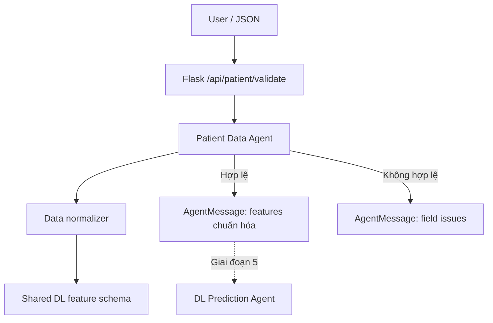

# GIAI ĐOẠN 3 — PATIENT DATA AGENT

**Project:** Hệ đa Agent hỗ trợ ra quyết định về bệnh tiểu đường — môn Phát triển các hệ thống thông minh (PTIT).

**Nguyên tắc:** Chỉ hoàn thành Giai đoạn 3, kiểm thử và chờ người dùng xác nhận trước khi làm Giai đoạn 4.

## 1. Đối chiếu tài liệu giảng viên

Theo `project_architecture_multiagent_diabet_v1.pdf`: §2 mô tả kiến trúc sáu tầng; §3.1 quy định Patient Data Agent kiểm tra đặc trưng, kiểu dữ liệu, dữ liệu thiếu và tính nhất quán; §5 yêu cầu Coordinator chạy Data Agent trước DL Agent và dừng nếu dữ liệu sai; §6 yêu cầu giao tiếp cấu trúc có `request_id`, `agent`, `status`, `payload`, `evidence`, `version`; §7.1 yêu cầu giữ đúng schema mô hình DL; §9 xếp input validation vào giai đoạn số 3.

Tài liệu PDF không quy định cụ thể phải chấp nhận định dạng chuỗi nào. Chính sách chuẩn hóa bên dưới là **lựa chọn triển khai đơn giản bổ sung**, dựa trên schema của model đã xây từ Giai đoạn 1; không phải luật y tế do giảng viên xác nhận.

### Chức năng của Giai đoạn 3

- `PatientDataAgent` nhận `features` thô, chuẩn hóa có kiểm soát và trả `AgentMessage`.
- `PatientDataNormalizer` kiểm tra đầu vào rồi kiểm tra lần cuối bằng `core.features.validate_features()` đã có.
- Bổ sung endpoint **`POST /api/patient/validate`** để demo riêng; **chưa tự động gọi DL**. Tích hợp phối hợp Agent dành cho Coordinator ở Giai đoạn 5.
- Giữ nguyên `/api/predict`, `/api/knowledge/query`, Neo4j, file model `.joblib`, cấu hình `.env`, và bản sửa Unicode `app.json.ensure_ascii = True`.
- `/api/assess` vẫn trả HTTP `501` vì hệ MAS chưa hoàn tất.



## 2. Các quy tắc kiểm tra dữ liệu

| Trường | Dữ liệu chuẩn | Quy tắc |
|---|---|---|
| `gender` | `Female`, `Male`, `Other` | Chấp nhận trim khoảng trắng, chữ hoa/thường và trả nhãn chuẩn |
| `age` | Số | Nhận số JSON hoặc chuỗi số dùng dấu chấm, giới hạn kỹ thuật 0–120 |
| `hypertension` | 0 hoặc 1 | Nhận integer 0/1 hoặc chuỗi `"0"`, `"1"` |
| `heart_disease` | 0 hoặc 1 | Như trên |
| `smoking_history` | Các nhãn trong `core/features.py` | Chỉ nhận nhãn đã biết, chuẩn hóa khoảng trắng/chữ hoa-thường |
| `bmi` | Số | Giới hạn kỹ thuật 0–150 |
| `HbA1c_level` | Số | Giới hạn kỹ thuật 0–30 |
| `blood_glucose_level` | Số | Giới hạn kỹ thuật 0–1000 |

**Lưu ý:** Đây là *giới hạn kiểm tra dữ liệu kỹ thuật của schema*, không phải ngưỡng chẩn đoán hay ngưỡng bình thường/bất thường về y khoa.

Ví dụ: `" female "` thành `Female`; `"27.32"` thành `27.32`; `"1"` trong trường nhị phân thành số `1`.

Những giá trị bị từ chối: thiếu trường, sai tên trường, trường thừa, `null`, boolean thay số, các giá trị vô cực/NaN, chuỗi có dấu phẩy thập phân như `"27,32"`, nhãn không nhận diện, số ngoài giới hạn. **Không điền giá trị thiếu, không tự sửa lỗi chính tả, không suy luận từ dữ liệu y tế**. Thông báo lỗi không xuất lại giá trị input sai. Agent chỉ chạy trong request, không lưu dữ liệu bệnh nhân vào DB.

## 3. Cập nhật ZIP vào project hiện tại

File **`diabetes-multiagent-giai-doan-3-cap-nhat.zip`** có thư mục gốc `diabetes-multiagent/`.

Giả sử project hiện có ở `D:\PTIT\N4-1\PTHTTM\diabetes-multiagent`:

1. Dừng Flask cũ bằng `Ctrl+C`.
2. Nếu từng sửa code, sao lưu **`backend/api/routes.py`** và **`backend/tests/test_api.py`** vì ZIP ghi đè hai file này.
3. Giải nén ZIP vào thư mục **cha** `D:\PTIT\N4-1\PTHTTM`, chọn ghi đè khi có file trùng. KHÔNG giải nén vào thư mục `diabetes-multiagent` làm lồng hai tầng.
4. Mở VS Code ở project cũ, tìm `backend/agents/patient_data_agent.py`.
5. **Không xóa:** `.venv`, `.env`, dataset, `models/diabetes_mlp_v1.joblib`, `config/model_manifest.json`, `outputs/dl_training_metrics.json` hoặc database Neo4j. ZIP không chứa những file đó.

### Những file được bổ sung hoặc cập nhật

```text
diabetes-multiagent/
├── backend/
│   ├── agents/patient_data_agent.py            [Mới]
│   ├── core/patient_data.py                    [Mới]
│   ├── api/routes.py                           [Cập nhật API]
│   ├── scripts/patient_data_cli.py             [Mới]
│   └── tests/
│       ├── test_api.py                        [Sửa assertion phase]
│       ├── test_patient_data_phase3.py        [16 unit tests mới]
│       └── test_patient_data_api_phase3.py    [6 API tests mới]
├── data/samples/
│   ├── patient_input_normalize.json           [Mới]
│   └── patient_input_invalid.json             [Mới]
├── docs/
│   ├── GIAI_DOAN_3_HUONG_DAN.md               [Mới]
│   └── roadmap.md                             [Cập nhật]
└── README.md                                  [Cập nhật]
```

**Không cần cài package mới** vì module Patient Data dùng Python chuẩn và tận dụng mã đã có. Nếu môi trường ảo của bạn chưa đủ dependency thì có thể chạy lại, nhưng không cần nếu đã dùng tốt ở Giai đoạn 2:

```powershell
.\.venv\Scripts\python.exe -m pip install -r requirements.txt
```

## 4. Test A — CLI chạy độc lập

Mở PowerShell trong **thư mục gốc** project:

```powershell
.\.venv\Scripts\python.exe backend/scripts/patient_data_cli.py data/samples/patient_input_normalize.json
```

Kết quả phải có: `"agent": "patient_data"`, `"status": "ok"`, `"valid": true`, và `payload.features` chứa đúng tám trường. Kiểm tra `gender` được đổi thành `Female`, `smoking_history` thành `never`, `age` thành `44.0`, và danh sách `normalizations` có ghi trường đã chuẩn hóa.

Thử mẫu có dữ liệu sai:

```powershell
.\.venv\Scripts\python.exe backend/scripts/patient_data_cli.py data/samples/patient_input_invalid.json
```

Lệnh này **cố ý trả exit code 2** khi phát hiện dữ liệu sai. Output phải có `status=error`, `payload.valid=false`, `payload.error_type=invalid_patient_data` và nhiều `issues` (thiếu trường, trường thừa, sai loại, sai giới hạn). **Đây là test PASS khi Agent biết từ chối input không hợp lệ**.

## 5. Test B — Toàn bộ unit tests

```powershell
.\.venv\Scripts\python.exe -m unittest discover -s backend/tests -v
```

**Kỳ vọng `Ran 47 tests` và `OK`**: 25 tests cũ + 16 test logic + 6 test Flask API. Nếu bạn thấy cảnh báo `ConvergenceWarning` ở test huấn luyện MLP với dữ liệu tổng hợp, cảnh báo đó không nhất thiết làm test thất bại; xem kết quả cuối là `OK` hay `FAILED`.

## 6. Test C — Chạy Flask và gọi API

**Terminal 1**, chạy:

```powershell
.\.venv\Scripts\python.exe backend/app.py
```

Chờ terminal hiện `Running on http://127.0.0.1:5000`, sau đó mở **Terminal 2**.

### C1. Health API

```powershell
Invoke-RestMethod http://127.0.0.1:5000/api/health | ConvertTo-Json -Depth 6
```

Kiểm tra:

```json
{
  "status": "ok",
  "phase": "3-patient-data-agent",
  "integrations": {
    "patient_data": "ready",
    "deep_learning": "ready",
    "neo4j": "ready"
  }
}
```

Đây là **trích các trường quan trọng**, phản hồi còn `service` và `disclaimer`. Hai trạng thái DL/Neo4j phải vẫn ready nếu các bước cũ đang hoạt động.

Kiểm tra danh sách Agent:

```powershell
Invoke-RestMethod http://127.0.0.1:5000/api/agents/status | ConvertTo-Json -Depth 8
```

`count` = 8; `patient_data`, `dl_prediction`, `kg_rag` phải có `status=ready`; các Agent chưa làm vẫn `not_implemented`.

### C2. API Patient Data với đầu vào hợp lệ

```powershell
$body = Get-Content .\data\samples\patient_input_normalize.json -Raw -Encoding UTF8
$result = Invoke-RestMethod `
  -Uri http://127.0.0.1:5000/api/patient/validate `
  -Method Post `
  -ContentType 'application/json; charset=utf-8' `
  -Body ([System.Text.Encoding]::UTF8.GetBytes($body))
$result | ConvertTo-Json -Depth 10
```

Mong đợi HTTP 200, `agent=patient_data`, `status=ok`, `payload.valid=true`; số trường trong `payload.feature_order` bằng 8. `payload.features` có `gender=Female`, `smoking_history=never` và số được chuyển sang JSON number.

### C3. API Patient Data với đầu vào lỗi

Windows PowerShell 5.1 thường ném exception khi HTTP 400, nên để xem cả status và JSON phản hồi, dùng `curl.exe`:

```powershell
curl.exe -i -X POST `
  -H 'Content-Type: application/json; charset=utf-8' `
  --data-binary '@data/samples/patient_input_invalid.json' `
  http://127.0.0.1:5000/api/patient/validate
```

Mong đợi **`HTTP/1.1 400 BAD REQUEST`**, `agent=patient_data`, `status=error`, `error_type=invalid_patient_data`; JSON có `issues` theo trường. Không chỉnh input sai chỉ để có `200`: từ chối đúng cũng là tính năng cần test.

### C4. Kiểm thử hồi quy API cũ

**Giai đoạn 1 (DL):**

```powershell
$body = Get-Content .\data\samples\predict_input.json -Raw -Encoding UTF8
Invoke-RestMethod -Uri http://127.0.0.1:5000/api/predict `
  -Method Post -ContentType 'application/json; charset=utf-8' `
  -Body ([System.Text.Encoding]::UTF8.GetBytes($body)) | ConvertTo-Json -Depth 8
```

Mong đợi `status=ok`, `agent=dl_prediction`, model trả `prediction` 0 hoặc 1 (không có nhãn dự đoán cố định).

**Giai đoạn 2 (KG/RAG):**

```powershell
$body = Get-Content .\data\samples\knowledge_query.json -Raw -Encoding UTF8
Invoke-RestMethod -Uri http://127.0.0.1:5000/api/knowledge/query `
  -Method Post -ContentType 'application/json; charset=utf-8' `
  -Body ([System.Text.Encoding]::UTF8.GetBytes($body)) | ConvertTo-Json -Depth 8
```

Mong đợi `status=ok`, `agent=kg_rag`, có `evidence` và URL nguồn; tiếng Việt vẫn đúng Unicode.

**Ghi nhớ:** `POST /api/assess` vẫn phải trả HTTP 501. Điều này đúng với lộ trình vì chưa có Coordinator.

## 7. Hợp đồng API và cấu trúc kết quả

**Request** `POST /api/patient/validate` có dạng:

```json
{"features": {
  "gender": " female ", "age": "44", "hypertension": "0", "heart_disease": 0,
  "smoking_history": " Never ", "bmi": "27.32",
  "HbA1c_level": "5.7", "blood_glucose_level": "140"
}}
```

**Khi hợp lệ**, `payload` gồm `valid=true`, `features` đã chuẩn hóa, `feature_order` (8 tên trường), `normalizations` (danh sách `{field, operation}`). Message có thêm `request_id`, `agent`, `status`, `evidence=[]`, `version=patient-data-v1`, `error=null`.

**Khi không hợp lệ**, `payload` gồm `valid=false`, `error_type=invalid_patient_data`, `issues` (mỗi issue `{field, code, message}`); không trả lại giá trị gốc bị lỗi. HTTP = 400.

## 8. Checklist nghiệm thu

- [ ] Giải nén đúng project cũ, không làm mất `.env` hoặc model.
- [ ] CLI input hợp lệ trả `status=ok`, chuẩn hóa 8 trường đúng.
- [ ] CLI input lỗi trả `status=error` và danh sách `issues`.
- [ ] **47 unit tests PASS**, kết thúc với `OK`.
- [ ] `/api/health`: `patient_data=ready`, `deep_learning=ready`, `neo4j=ready`.
- [ ] `/api/agents/status`: 8 agent, ba Agent đang triển khai là ready.
- [ ] `/api/patient/validate`: HTTP 200 với dữ liệu hợp lệ.
- [ ] `/api/patient/validate`: HTTP 400 và lỗi có cấu trúc với dữ liệu sai.
- [ ] `/api/predict` và `/api/knowledge/query` vẫn hoạt động, tiếng Việt đúng.

**Bạn cần gửi lại:** (1) `Ran ... tests / OK`; (2) JSON `/api/health`; (3) kết quả `payload` của `/api/patient/validate` thành công; (4) một số issue của input sai. Không gửi mật khẩu `.env` hoặc dữ liệu bệnh nhân thật.

**Sau khi bạn xác nhận PASS mới chuyển sang Giai đoạn 4 — Rule-Based Agent.**
