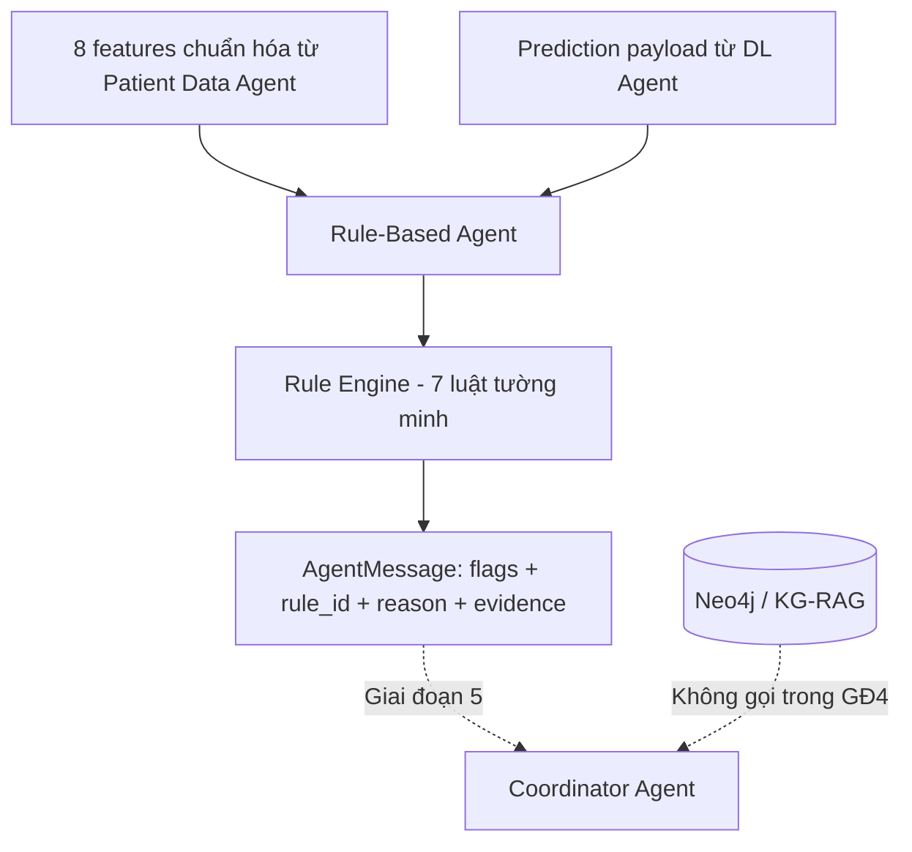

# GIAI ĐOẠN 4 — RULE-BASED AGENT

**Đề tài:** Hệ đa Agent hỗ trợ ra quyết định về bệnh tiểu đường — Project cuối môn Phát triển các hệ thống thông minh (PTIT).

**Trạng thái:** Giai đoạn 0–3 đã được người dùng nghiệm thu. **Giai đoạn 4 chỉ được coi là hoàn thành sau khi kiểm thử PASS trên máy người dùng và được xác nhận. Không bắt đầu Giai đoạn 5 trước khi có xác nhận.**

## 1. Đúng kiến trúc của giảng viên như thế nào?

Tài liệu `docs/references/project_architecture_multiagent_diabet_v1.pdf` quy định:

- **§2:** Kiến trúc 6 tầng, Rule-Based Agent nằm trong Intelligent Agent Layer; dữ liệu, mô hình và KG/RAG tách biệt.
- **§3.1:** Rule-Based Agent áp dụng **luật tường minh** để tạo các cờ có thể kiểm tra và giải thích (auditable flags).
- **§3.2:** Một Agent làm một nhiệm vụ, interface rõ ràng, kết quả có căn cứ, lỗi không bị che giấu.
- **§5:** Trong luồng MAS, Data Agent kiểm tra dữ liệu → DL Agent dự đoán → Rule Agent áp dụng luật → KG/RAG truy xuất → Coordinator tổng hợp → Explanation Agent báo cáo.
- **§6.1–6.3:** Hợp đồng `AgentMessage` gồm request id, agent, status, payload, evidence, version. **Đầu vào Rule Agent là các features hợp lệ và dự đoán của DL Agent; đầu ra là kết quả áp dụng luật và cờ cần xem xét.**
- **§9 Phase 4:** triển khai explicit rules và bàn giao Rule-Based Agent.
- **§10:** Không xác nhận chẩn đoán, không kê thuốc/liều điều trị. Luật y khoa phải được chuyên gia thẩm định trước khi dùng trên bệnh nhân thật.

**Điểm cần phân biệt:** Tài liệu PDF không liệt kê cụ thể các luật hoặc ngưỡng. **7 luật dưới đây do chúng ta bổ sung để minh họa môn học**, không phải danh sách đã được giảng viên hay chuyên gia y tế xác nhận. Ngưỡng tham khảo NIDDK chỉ kích hoạt cờ cần diễn giải, không tự chẩn đoán.

## 2. Kiến trúc phần xây dựng



Giai đoạn 4 có 2 API **độc lập**:

- `GET /api/rules/catalog`: danh sách 7 luật, điều kiện, nguồn, không cần database/model.
- `POST /api/rules/evaluate`: người gọi cung cấp `features` **đã chuẩn hóa** và `prediction` **theo đúng payload của DL Agent**. API chưa tự gọi các Agent khác; **Giai đoạn 5** mới thực hiện việc này.

Các API cũ phải giữ nguyên. `/api/assess` vẫn trả HTTP 501.

## 3. Danh sách luật demo

| Mã | Khi nào bật cờ | Severity | Mục đích |
|---|---|---|---|
| RB001 | `5.7 <= HbA1c_level < 6.5` | `review` | Đánh dấu khoảng HbA1c tham khảo cần diễn giải |
| RB002 | `HbA1c_level >= 6.5` | `review` | Đánh dấu ngưỡng HbA1c tham khảo và giới hạn sử dụng |
| RB003 | `blood_glucose_level >= 200` | `review` | Thiếu thông tin loại xét nghiệm/thời điểm/triệu chứng; chỉ áp dụng với **giả định đơn vị dataset mg/dL** |
| RB004 | `smoking_history == 'No Info'` | `info` | Nhắc thiếu dữ liệu, không tự điền |
| RB005 | `prediction.prediction == 1` | `review` | Nhắc nhãn dataset lớp 1 không đồng nghĩa chẩn đoán |
| RB006 | `prediction.prediction == 0` và `HbA1c_level >= 6.5` | `review` | Cờ cần đối chiếu dữ liệu và mô hình, không kết luận nguồn nào đúng |
| RB007 | `prediction.score_is_calibrated == false` | `info` | Nhắc điểm mô hình chưa hiệu chuẩn, không phải xác suất mắc bệnh thật |

Các luật này chỉ dùng dữ liệu đầu vào và payload DL; **không áp dụng treatment / medication rules**. Đặc biệt với RB003, `blood_glucose_level` trong dataset thiếu bối cảnh xét nghiệm; mức 200 chỉ kích hoạt yêu cầu xem xét, không được coi là kết quả chẩn đoán. Khi ứng dụng ngoài môi trường học tập, phải kiểm chứng **đơn vị, kiểu xét nghiệm và dữ liệu thực tế**.

**Nguồn quy tắc tham khảo:**

1. NIDDK, *Diabetes Tests & Diagnosis*: https://www.niddk.nih.gov/health-information/diabetes/overview/tests-diagnosis
2. NIDDK, *The A1C Test & Diabetes*: https://www.niddk.nih.gov/health-information/diagnostic-tests/a1c-test/
3. Hợp đồng schema nội bộ: `backend/core/features.py`; các luật về nhãn dự đoán sử dụng đặc tả `backend/services/dl_service.py`.

NIDDK lưu ý các xét nghiệm cần được diễn giải theo bối cảnh, thường cần xác nhận bằng xét nghiệm bổ sung và có giới hạn đặc biệt (ví dụ thai kỳ, biến thể hemoglobin). Các cờ được xây dựng không phải là phân loại chẩn đoán cá nhân.

## 4. Cập nhật ZIP vào project Giai đoạn 3

Giả sử project hiện ở `D:\PTIT\N4-1\PTHTTM\diabetes-multiagent`:

1. Dừng Flask trong Terminal bằng `Ctrl+C`.
2. Sao lưu file nếu đã tự sửa: `backend/api/routes.py`, `backend/tests/test_api.py`, `backend/tests/test_patient_data_api_phase3.py`, `README.md`, `docs/roadmap.md`.
3. **Giải nén ZIP vào thư mục cha** `D:\PTIT\N4-1\PTHTTM`, bật ghi đè file trùng tên. ZIP có thư mục gốc `diabetes-multiagent/` nên **không giải nén vào bên trong** `diabetes-multiagent` (tránh thư mục lồng nhau).
4. Mở lại project trong VS Code.
5. Giữ nguyên `.venv`, `.env`, mô hình `models/*.joblib`, `config/model_manifest.json`, dữ liệu dataset, Neo4j đã seed. Không cần huấn luyện lại model, không cần seed lại Neo4j, không cần cài thêm package.

### 4.1 Các file mới/thay đổi

```text
diabetes-multiagent/
├── backend/
│   ├── rules/
│   │   ├── __init__.py                   [MỚI]
│   │   ├── rule_engine.py                [MỚI: 7 luật]
│   │   └── README.md                     [CẬP NHẬT]
│   ├── agents/
│   │   └── rule_based_agent.py           [MỚI]
│   ├── scripts/
│   │   └── rules_cli.py                  [MỚI]
│   ├── api/
│   │   └── routes.py                     [CẬP NHẬT: 2 endpoint + readiness]
│   └── tests/
│       ├── test_rule_based_phase4.py     [MỚI: 23 unit tests]
│       ├── test_rule_based_api_phase4.py [MỚI: 8 HTTP tests]
│       ├── test_api.py                   [CẬP NHẬT: phase string]
│       └── test_patient_data_api_phase3.py [CẬP NHẬT: phase string]
├── data/samples/
│   ├── rule_input_demo.json              [MỚI: FIXTURE GIẢ LẬP, KHÔNG PHẢI MODEL THẬT]
│   └── rule_input_invalid.json           [MỚI]
├── docs/
│   ├── GIAI_DOAN_4_HUONG_DAN.md          [MỚI]
│   └── roadmap.md                        [CẬP NHẬT]
└── README.md                              [CẬP NHẬT]
```

## 5. Kiểm thử theo thứ tự

**Mở PowerShell trong VS Code tại đúng thư mục `diabetes-multiagent`.** Mọi lệnh sau đều chạy từ thư mục gốc project.

### Bước 1 — Chạy CLI với dữ liệu giả lập

```powershell
.\.venv\Scripts\python.exe backend/scripts/rules_cli.py data/samples/rule_input_demo.json
```

Mong đợi trong JSON:

```json
{
  "agent": "rule_based",
  "status": "ok",
  "payload": {
    "rule_set_version": "edu-rule-set-v1",
    "rules_evaluated": 7,
    "triggered_rules_count": 5,
    "review_required": true
  }
}
```

Đây là đoạn trích, không phải toàn bộ response. Các ID luật kích hoạt: `RB002`, `RB003`, `RB004`, `RB006`, `RB007`.

**Cảnh báo:** File `rule_input_demo.json` chứa `prediction` **giả lập chỉ để kiểm thử**, có `model_version: SYNTHETIC_FIXTURE_ONLY`. Không báo cáo đây là kết quả của mô hình đã huấn luyện. Ở Bước 5 sẽ lấy kết quả dự đoán thực từ `/api/predict`.

Kiểm tra lỗi đầu vào:

```powershell
.\.venv\Scripts\python.exe backend/scripts/rules_cli.py data/samples/rule_input_invalid.json
$LASTEXITCODE
```

Kỳ vọng: `status: error`, `error_type: invalid_rule_input`, mã thoát `2` (đúng thiết kế).

### Bước 2 — Kiểm thử logic 7 luật

```powershell
.\.venv\Scripts\python.exe -m unittest discover -s backend/tests -p test_rule_based_phase4.py -v
```

Kỳ vọng: `Ran 23 tests`, `OK`.

### Bước 3 — Kiểm thử toàn bộ project

```powershell
.\.venv\Scripts\python.exe -m unittest discover -s backend/tests -v
```

Kỳ vọng: `Ran 78 tests`, `OK`.

Tổng 78 = 47 tests Giai đoạn 3 (đã PASS trên máy bạn) + 23 unit tests Rule + 8 HTTP tests Rule. Khi chạy test DL với dữ liệu tổng hợp nhỏ có thể có cảnh báo scikit-learn về batch size/convergence; chỉ xem như cảnh báo trong test, không thay thế kiểm định chất lượng model thật.

### Bước 4 — Chạy Flask & xem trạng thái

Mở **Terminal 1**, chạy:

```powershell
.\.venv\Scripts\python.exe backend/app.py
```

Mở **Terminal 2**, chạy:

```powershell
Invoke-RestMethod http://127.0.0.1:5000/api/health | ConvertTo-Json -Depth 7
```

Kỳ vọng:

```json
{
  "status": "ok",
  "phase": "4-rule-based-agent",
  "integrations": {
    "patient_data": "ready",
    "rule_based": "ready",
    "deep_learning": "ready",
    "neo4j": "ready"
  }
}
```

Phần trên chỉ trích các trường quan trọng. Kiểm tra tiếp catalog Agent:

```powershell
Invoke-RestMethod http://127.0.0.1:5000/api/agents/status | ConvertTo-Json -Depth 5
```

Phải có `count: 8`, Agent `rule_based` là `ready`, `coordinator`, `explanation`, `monitoring` vẫn `not_implemented`.

### Bước 5 — Gọi API Rule-Based Agent bằng kết quả **DL thật**

Đầu tiên xem catalog luật:

```powershell
Invoke-RestMethod http://127.0.0.1:5000/api/rules/catalog | ConvertTo-Json -Depth 8
```

Phải có `count: 7` và luật `RB001`–`RB007`.

Lấy input feature demo của Giai đoạn 1, gọi model thực tại `/api/predict` rồi gửi kết quả vào Rule Agent:

```powershell
$raw = Get-Content .\data\samples\predict_input.json -Raw -Encoding UTF8
$inputObject = $raw | ConvertFrom-Json

$dl = Invoke-RestMethod `
  -Uri http://127.0.0.1:5000/api/predict `
  -Method Post `
  -ContentType "application/json; charset=utf-8" `
  -Body ([System.Text.Encoding]::UTF8.GetBytes($raw))

$dl.status
$dl.payload.model_version

$ruleRequest = @{
  features   = $inputObject.features
  prediction = $dl.payload
} | ConvertTo-Json -Depth 12

$result = Invoke-RestMethod `
  -Uri http://127.0.0.1:5000/api/rules/evaluate `
  -Method Post `
  -ContentType "application/json; charset=utf-8" `
  -Body ([System.Text.Encoding]::UTF8.GetBytes($ruleRequest))

$result.status
$result.agent
$result.payload.rules_evaluated
$result.payload.flags | Select-Object rule_id, severity, title, message | Format-Table -Wrap
$result.evidence | ConvertTo-Json -Depth 5
```

Kỳ vọng:

- `$dl.status` là `ok` và `$dl.payload.model_version` phải là model version **thật của bạn**, không phải `SYNTHETIC_FIXTURE_ONLY`.
- `$result.status` là `ok`, `agent` là `rule_based` và `rules_evaluated` là `7`.
- Số cờ và các ID kích hoạt phụ thuộc **dữ liệu mẫu + dự đoán thật của model**, không cố định 5 như file fixture.
- Mỗi flag có mã luật, điều kiện, nguồn, lời giải thích. `evidence` chứa nguồn của các luật đã kích hoạt.

Lưu ý: API Giai đoạn 4 nhận payload dự đoán từ client, chưa xác thực đó thực sự đến từ model. **Giai đoạn 5 sẽ thay thế cách ghép thủ công này bằng Coordinator, để nhận kết quả trực tiếp từ DL Agent**, không để user tự cung cấp prediction trong luồng MAS.

### Bước 6 — Kiểm tra HTTP 400 khi dữ liệu sai

```powershell
curl.exe -i -X POST `
  -H "Content-Type: application/json; charset=utf-8" `
  --data-binary "@data/samples/rule_input_invalid.json" `
  http://127.0.0.1:5000/api/rules/evaluate
```

Kỳ vọng: `HTTP/1.1 400 BAD REQUEST`, `status: error`, `error_type: invalid_rule_input`.

### Bước 7 — Regression (các phần cũ không được hỏng)

```powershell
Invoke-RestMethod http://127.0.0.1:5000/api/health | ConvertTo-Json -Depth 6
```

Kiểm tra lại lần lượt:

- `POST /api/patient/validate` với `data/samples/patient_input_normalize.json` → HTTP 200.
- `POST /api/predict` với `data/samples/predict_input.json` → HTTP 200, có prediction thật.
- `POST /api/knowledge/query` với `data/samples/knowledge_query.json` → HTTP 200, có nguồn, tiếng Việt đúng.
- `POST /api/assess` → vẫn là HTTP 501: **Coordinator chưa triển khai**.

Nếu chạy test thấy API 404, hãy kiểm tra bạn đã cập nhật đúng `backend/api/routes.py` và đã khởi động lại Flask.

## 6. Hợp đồng đầu vào / đầu ra

`POST /api/rules/evaluate` yêu cầu JSON:

```json
{
  "features": {
    "gender": "Female",
    "age": 44,
    "hypertension": 0,
    "heart_disease": 0,
    "smoking_history": "never",
    "bmi": 27.32,
    "HbA1c_level": 5.7,
    "blood_glucose_level": 140
  },
  "prediction": {
    "prediction": 0,
    "model_score_class_1": 0.22,
    "score_is_calibrated": false,
    "output_kind": "dataset_label_classification",
    "model_version": "EXAMPLE_ONLY",
    "input_feature_names": [
      "gender", "age", "hypertension", "heart_disease",
      "smoking_history", "bmi", "HbA1c_level", "blood_glucose_level"
    ]
  }
}
```

**Chú ý:** prediction trong ví dụ trên là ví dụ mô tả cấu trúc, không phải đo lường thực tế. Khi demo kết quả học thuật phải dùng `$dl.payload` từ `/api/predict` như Bước 5.

Phản hồi có hợp đồng `AgentMessage`:

- `request_id`, `agent: rule_based`, `status: ok/error`, `payload`, `evidence`, `version`, `error`.
- `payload.evaluations`: mọi luật được kiểm tra theo thứ tự, có `triggered: true/false`.
- `payload.flags`: **chỉ những luật kích hoạt**, gồm `rule_id`, `criterion`, `severity`, `category`, `message`, `requires_human_review`, `source`.
- `evidence`: mô tả nguồn tham khảo của từng luật; **không phải nguồn KG/RAG truy xuất trực tiếp**.
- Khi input sai: HTTP 400, `error_type: invalid_rule_input`, không echo giá trị dữ liệu bệnh nhân sai.
- `score_is_calibrated` chỉ là thông tin do DL Service cung cấp; model hiện chưa xác thực xác suất mắc bệnh.

## 7. Checklist nghiệm thu và báo cáo

- [ ] Đã chép đúng các file Giai đoạn 4 vào project (không làm mất model/Neo4j).
- [ ] CLI với `rule_input_demo.json` trả `ok`, `rules_evaluated=7`, `triggered_rules_count=5`.
- [ ] CLI với `rule_input_invalid.json` trả lỗi hợp lệ.
- [ ] **23 test** logic Rule-Based PASS.
- [ ] **78 test** tổng project PASS.
- [ ] `/api/health`: `rule_based`, `patient_data`, `deep_learning`, `neo4j` đều `ready`.
- [ ] `/api/rules/catalog`: có 7 luật.
- [ ] `/api/rules/evaluate`: khi lấy payload DL thật thì trả kết quả và evidence.
- [ ] Input sai qua API bị chặn bằng HTTP 400.
- [ ] Các API cũ còn hoạt động; `/api/assess` vẫn 501.

**Bạn hãy gửi lại:** (1) phần cuối log `Ran 78 tests ... OK`, (2) JSON `/api/health`, (3) kết quả `$result.payload.flags` và `$result.evidence` trong Bước 5, (4) xác nhận `/api/predict`, `/api/knowledge/query` vẫn hoạt động. Không gửi `.env`, mật khẩu hoặc dữ liệu bệnh nhân thật.

**Dừng tại Giai đoạn 4.** Chỉ sau khi bạn xác nhận hoàn thành, chúng ta mới làm Giai đoạn 5 — Coordinator Agent.
