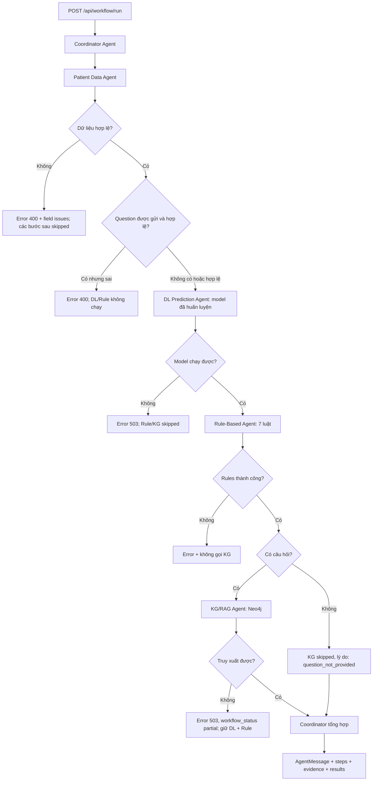

# GIAI ĐOẠN 5 — COORDINATOR AGENT (ĐIỀU PHỐI ĐA AGENT)

**Môn học:** Phát triển các hệ thống thông minh — PTIT  
**Đề tài:** Hybrid Multiagent System for Diabetes Decision Support  
**Điều kiện đầu vào:** Bạn đã tự xác nhận Giai đoạn 0–4 hoàn thành, Giai đoạn 4 đạt 78/78 tests trên máy Windows.  
**Mục tiêu lần này:** tích hợp **Patient Data → DL Prediction → Rule-Based → KG/RAG** trong một luồng chạy, giữ bằng chứng, trace và lỗi tường minh. **KHÔNG triển khai Explanation Agent/Monitoring Agent ở bước này.**

> Chỉ chuyển sang Giai đoạn 6 khi toàn bộ kiểm thử Giai đoạn 5 PASS và bạn xác nhận rõ ràng.

## 1. Đối chiếu với tài liệu giảng viên

Đặc tả chính: `docs/references/project_architecture_multiagent_diabet_v1.pdf`.

- §2 (kiến trúc 6 lớp): Coordinator thuộc **Multiagent Coordination Layer**, không thay mô hình DL hoặc KG/RAG.
- §3 (vai trò): Coordinator phân công, thu nhận và kết hợp kết quả; mỗi Agent giữ một chức năng.
- §5 (workflow tuần tự): API tiếp nhận → Patient Data Agent xác thực → DL Prediction Agent dự đoán → Rule-Based Agent đánh giá → KG/RAG Agent truy xuất → Coordinator tổng hợp → Explanation Agent báo cáo → Monitoring Agent ghi metadata → trả kết quả.
- §6 (hợp đồng): mỗi Agent có `request_id`, `agent`, `status`, `payload`, `evidence`, `version`, `error` (field `error` là mở rộng của project).
- §9 Phase 5: triển khai Coordinator Agent. Hai Agent giải thích và giám sát thuộc các giai đoạn tiếp theo; phiên bản hiện tại chỉ trả **kết quả tổng hợp có cấu trúc** và **trace trong response**, chưa phải báo cáo giải thích hoặc nhật ký bền vững.
- §10: không chẩn đoán, không kê đơn; truy xuất chỉ là thông tin có nguồn; không khẳng định score DL là xác suất mắc bệnh.

**Lựa chọn kỹ thuật bổ sung cho project cuối môn:** chạy các Agent bằng method `run()` ngay trong một backend Flask; không dựng queue, Kafka, microservices. Nếu request không có `question`, KG/RAG được ghi `skipped` (vì PDF cho phép câu hỏi tùy chọn). Đây là quy ước triển khai của project, không phải nguyên văn trong PDF.

## 2. Sơ đồ luồng



**Quan trọng:** `results` giữ **4 nhánh riêng**; không trộn nhãn mô hình vào flags của rule, không biến evidence thành chẩn đoán. `steps` chỉ chứa metadata (Agent, trạng thái, version, thời gian chạy, error_type), không ghi raw features hay câu hỏi. Trong bản này **không tự ghi trace ra SQLite/file**.

## 3. Tệp mới/cập nhật

Bản ZIP chứa thư mục gốc `diabetes-multiagent/`. Chỉ bổ sung hoặc thay đổi các file sau:

```text
diabetes-multiagent/
├── backend/
│   ├── coordinator/
│   │   ├── __init__.py                      [MỚI]
│   │   └── coordinator_agent.py             [MỚI: điều phối, xử lý lỗi, trace]
│   ├── api/
│   │   └── routes.py                        [SỬA: /api/workflow/run, phase, readiness]
│   ├── scripts/
│   │   └── workflow_cli.py                  [MỚI: chạy luồng với model và Neo4j thật]
│   └── tests/
│       ├── test_coordinator_phase5.py       [MỚI: 28 unit tests logic]
│       ├── test_coordinator_api_phase5.py   [MỚI: 14 HTTP tests]
│       ├── test_api.py                      [SỬA: phase string, giữ 501 assess]
│       ├── test_patient_data_api_phase3.py  [SỬA: phase string và Coordinator status]
│       └── test_rule_based_api_phase4.py    [SỬA: phase string và Coordinator status]
├── data/samples/
│   ├── workflow_with_question.json         [MỚI]
│   ├── workflow_without_question.json      [MỚI]
│   └── workflow_invalid.json               [MỚI]
├── docs/
│   ├── GIAI_DOAN_5_HUONG_DAN.md            [MỚI]
│   └── roadmap.md                          [SỬA]
└── README.md                               [SỬA]
```

Không ghi đè `.venv`, `.env`, `models/`, `config/model_manifest.json`, dataset hoặc `data/knowledge/DB_diabet.cypher`. **Không cần cài thêm thư viện**, train lại model hay seed lại Neo4j.

## 4. Hướng dẫn cài đặt vào project đang dùng

Project của bạn ở `D:\PTIT\N4-1\PTHTTM\diabetes-multiagent`.

1. **Dừng Flask** đang chạy trong VS Code bằng `Ctrl+C`.
2. Nếu tự sửa các file thuộc danh sách **SỬA** ở mục 3, sao lưu bản đang dùng trước.
3. Giải nén `diabetes-multiagent-giai-doan-5-cap-nhat.zip` vào **thư mục cha** `D:\PTIT\N4-1\PTHTTM`, chọn **ghi đè** file trùng tên. Không giải nén vào bên trong `diabetes-multiagent`, nếu không sẽ tạo thư mục lồng nhau.
4. Mở VS Code tại `D:\PTIT\N4-1\PTHTTM\diabetes-multiagent` và mở PowerShell.
5. Không cần tạo lại `.venv` hoặc `.env`. Nếu đổi máy, cài dependencies bằng `\.venv\Scripts\python.exe -m pip install -r requirements.txt` sau khi đã tạo môi trường.

## 5. Kiểm thử tuần tự (chỉ qua bước kế khi bước trước PASS)

### Bước 1: Kiểm tra file Coordinator

```powershell
Test-Path .\backend\coordinator\coordinator_agent.py
Test-Path .\backend\scripts\workflow_cli.py
Test-Path .\data\samples\workflow_with_question.json
```

Kỳ vọng cả ba dòng `True`.

### Bước 2: Chạy riêng 28 test logic Coordinator

```powershell
.\.venv\Scripts\python.exe -m unittest discover -s backend/tests -p test_coordinator_phase5.py -v
```

Kỳ vọng:

```text
Ran 28 tests in ...s
OK
```

Các test này **không cần model thật/Neo4j thật** vì sử dụng DL/KG mock với nhãn riêng `TEST_FIXTURE_NOT_REAL_MODEL`. Không sử dụng kết quả fixture để báo cáo hiệu năng mô hình y tế.

### Bước 3: Kiểm thử hồi quy toàn project

```powershell
.\.venv\Scripts\python.exe -m unittest discover -s backend/tests -v
```

Kỳ vọng:

```text
Ran 120 tests in ...s
OK
```

120 = 78 bài của Giai đoạn 4 + 28 bài logic Coordinator + 14 bài API Coordinator. Cảnh báo `ConvergenceWarning` hoặc batch_size khi huấn luyện **dữ liệu tổng hợp nhỏ** ở một test DL không đồng nghĩa `FAIL`, nhưng cần phân biệt với đánh giá mô hình thật.

### Bước 4: Thử qua CLI bằng model và Neo4j **thật**

```powershell
.\.venv\Scripts\python.exe backend/scripts/workflow_cli.py data/samples/workflow_with_question.json
```

Xem các trường sau trong JSON trả về:

```json
{
  "agent": "coordinator",
  "status": "ok",
  "payload": {
    "workflow_status": "completed",
    "knowledge_status": "ok",
    "explanation_status": "not_implemented",
    "monitoring_status": "not_implemented",
    "report_ready": false
  }
}
```

Đây chỉ là **các trường quan trọng**, không phải JSON đầy đủ. Trong `payload.steps` cần có bốn Agent theo thứ tự: `patient_data`, `dl_prediction`, `rule_based`, `kg_rag`. Trong `payload.results.dl_prediction` phải có dự đoán từ model thật; `rule_based.rules_evaluated = 7`; `kg_rag.retrieved_fact_count` phải có dữ liệu nếu câu hỏi phù hợp. Trong `evidence` phải có nguồn từ Neo4j và/hoặc luật.

**Lưu ý:** Với CLI, nếu PowerShell hiển thị sai dấu, dùng API ở Bước 6 để kiểm tra Unicode. API vẫn giữ `app.json.ensure_ascii=True` của Giai đoạn 2.

### Bước 5: Kiểm tra trường hợp không có `question`

```powershell
.\.venv\Scripts\python.exe backend/scripts/workflow_cli.py data/samples/workflow_without_question.json
```

Kỳ vọng `status=ok`, `workflow_status=completed`, `knowledge_status=skipped`, `steps[3].status=skipped` và không có `results.kg_rag`. DL và Rule vẫn chạy bình thường.

Thử dữ liệu sai:

```powershell
.\.venv\Scripts\python.exe backend/scripts/workflow_cli.py data/samples/workflow_invalid.json
$LASTEXITCODE
```

Kỳ vọng `status=error`, `payload.error_type=invalid_patient_data`, `steps` cho biết 3 bước sau đã `skipped`, `$LASTEXITCODE=2`. `problems[0].issues` chứa lỗi trường `bmi`. Giá trị `27,32` bị từ chối vì chuẩn số dạng `27.32`.

### Bước 6: Khởi động Flask và kiểm tra API

Terminal 1:

```powershell
.\.venv\Scripts\python.exe backend/app.py
```

Terminal 2, cùng thư mục project:

```powershell
Invoke-RestMethod http://127.0.0.1:5000/api/health | ConvertTo-Json -Depth 8
```

Kỳ vọng:

```json
{
  "status": "ok",
  "phase": "5-coordinator-agent",
  "integrations": {
    "patient_data": "ready",
    "deep_learning": "ready",
    "neo4j": "ready",
    "rule_based": "ready",
    "coordinator": "ready"
  }
}
```

Đó là **đoạn trích** — response đầy đủ còn `service`, `disclaimer`. `coordinator: ready` chỉ chứng minh Coordinator đã khởi tạo; phải kiểm tra DL/Neo4j riêng.

Gọi workflow thực bằng dữ liệu mẫu UTF-8:

```powershell
$raw = Get-Content .\data\samples\workflow_with_question.json -Raw -Encoding UTF8
$result = Invoke-RestMethod `
  -Uri http://127.0.0.1:5000/api/workflow/run `
  -Method Post `
  -ContentType 'application/json; charset=utf-8' `
  -Body ([System.Text.Encoding]::UTF8.GetBytes($raw))

$result.agent
$result.status
$result.request_id
$result.payload.workflow_status
$result.payload.steps | Format-Table agent,status,version,duration_ms,error_type -AutoSize
$result.payload.results.dl_prediction | ConvertTo-Json -Depth 6
$result.payload.results.rule_based | Select-Object rules_evaluated, triggered_rules_count, review_required
$result.payload.results.kg_rag.answer
$result.evidence | Select-Object -First 2 | ConvertTo-Json -Depth 6
```

Kỳ vọng HTTP 200, `agent=coordinator`, `status=ok`, `workflow_status=completed`, 4 steps `ok`, có `request_id`, DL prediction và rule results có cấu trúc, KG answer có nguồn, chữ tiếng Việt hiển thị đúng.

### Bước 7: Kiểm tra API với dữ liệu sai

Dùng `curl.exe` để nhìn thấy HTTP 400 mà không phải xử lý PowerShell exception:

```powershell
curl.exe -i -X POST `
  -H 'Content-Type: application/json; charset=utf-8' `
  --data-binary '@data/samples/workflow_invalid.json' `
  http://127.0.0.1:5000/api/workflow/run
```

Kỳ vọng **HTTP 400**, `status=error`, `payload.error_type=invalid_patient_data`, có `problems[].issues`; DL/Rule/KG không chạy.

Thử lỗi question (không sửa file):

```powershell
curl.exe -i -X POST `
  -H 'Content-Type: application/json; charset=utf-8' `
  --data-binary '{"features":{},"question":""}' `
  http://127.0.0.1:5000/api/workflow/run
```

Lệnh trên chắc chắn trả HTTP 400; vì `features` không hợp lệ, nó kiểm tra ưu tiên lỗi Patient Data. Trường hợp **question không hợp lệ nhưng features hợp lệ** được kiểm tra trong `test_coordinator_phase5.py` và `test_coordinator_api_phase5.py`.

### Bước 8: Kiểm tra hồi quy và trạng thái chưa triển khai

```powershell
Invoke-RestMethod http://127.0.0.1:5000/api/agents/status | ConvertTo-Json -Depth 5
Invoke-RestMethod http://127.0.0.1:5000/api/rules/catalog | Select-Object count
```

Trạng thái: `count=8`, `coordinator=ready`; `explanation`, `monitoring`, `rl` vẫn `not_implemented`. Catalog luật `count=7`.

Kiểm tra lại API cũ `/api/patient/validate`, `/api/predict`, `/api/knowledge/query`, `/api/rules/evaluate` bằng lệnh Giai đoạn 1–4 bạn đã dùng. **Không chạy lại huấn luyện và không seed lại Neo4j.**

`POST /api/assess` vẫn **HTTP 501**, là **đúng thiết kế ở Giai đoạn 5**, vì chưa có Explanation Agent và Monitoring Agent; sử dụng `/api/workflow/run` cho luồng Coordinator.

## 6. Response contract và cách đọc lỗi

Response của `/api/workflow/run` là `AgentMessage` ngoài cùng:

| Trường | Ý nghĩa |
|---|---|
| `request_id` | UUID mới sinh cho mỗi request, dùng chung qua các Agent |
| `agent` | `coordinator` |
| `status` | `ok` hoặc `error` |
| `payload.workflow_status` | `completed`, `failed` hoặc `partial` |
| `payload.results.patient_data` | Features chuẩn hóa hoặc `null` nếu Agent lỗi |
| `payload.results.dl_prediction` | Kết quả model DL thật hoặc `null` |
| `payload.results.rule_based` | 7 luật và cờ kích hoạt hoặc `null` |
| `payload.results.kg_rag` | Kết quả truy xuất Neo4j hoặc `null` (có thể do không nhập question) |
| `payload.steps` | Metadata thực thi, thứ tự, status, version, duration_ms, error_type |
| `payload.problems` | Agent gặp lỗi, loại lỗi, mô tả; `issues` chi tiết với dữ liệu Patient không hợp lệ |
| `evidence` | Chứng cứ có nguồn, gắn với Agent xuất phát |
| `report_ready` | `false` — chưa có báo cáo Explanation cuối cùng |

HTTP mapping:

| Trường hợp | HTTP | `workflow_status` |
|---|---:|---|
| 4 Agent thành công (hoặc KG skipped do không nhập question) | 200 | `completed` |
| Patient Data sai / question sai | 400 | `failed` |
| Model không có/không chạy được | 503 | `failed` |
| Neo4j lỗi sau khi DL/Rule đã chạy | 503 | `partial` — không che giấu lỗi |
| Agent trả sai contract hoặc lỗi nội bộ | 500 | `failed` / `partial` |

**Không có evidence không đồng nghĩa lỗi:** KG Agent có thể trả `response_kind='no_evidence'`; lúc đó `evidence` KG rỗng, hệ thống phải hiển thị rõ không tìm thấy thông tin, tuyệt đối không tự bịa nội dung.

## 7. Nếu gặp lỗi

- `ModuleNotFoundError`: dùng chính `.venv` đã chạy giai đoạn trước; kiểm tra đang ở thư mục gốc; nếu cần `\.venv\Scripts\python.exe -m pip install -r requirements.txt`.
- Flask báo port đã được sử dụng: dừng Flask cũ bằng `Ctrl+C`, rồi mới chạy lại.
- `model_unavailable`/HTTP 503: kiểm tra `config/model_manifest.json` và `models/diabetes_mlp_v1.joblib`; không sửa manifest thủ công, không tự giả lập dự đoán.
- `neo4j_unavailable`/HTTP 503: kiểm tra AuraDB, `.env`, test Giai đoạn 2; **không đưa mật khẩu `.env` vào chat**. Coordinator vẫn trả phần DL/Rules đã tính, `workflow_status=partial`.
- `HTTP 400` dữ liệu: xem `payload.problems[0].issues` và sửa trường được báo; không tự điền thiếu giá trị.
- Ký tự tiếng Việt sai trong PowerShell: giữ nguyên `app.json.ensure_ascii=True` ở `backend/app.py`; gửi body bằng UTF-8 bytes như lệnh Bước 6, **không cần seed lại Neo4j**.
- Số test khác 120: kiểm tra ZIP đã giải nén vào đúng thư mục cha, không có thư mục `diabetes-multiagent/diabetes-multiagent`.

## 8. Điều kiện nghiệm thu và dừng

Bạn chỉ xác nhận PASS nếu:

1. Có đủ file mới và không mất model/dataset/Neo4j.
2. 28 test Coordinator logic PASS.
3. Toàn bộ **120 tests PASS**.
4. CLI với question chạy đủ 4 Agent thành công bằng **DL và Neo4j thật**.
5. CLI không question chạy DL + Rules, KG `skipped`.
6. CLI dữ liệu sai trả lỗi, không chạy xuống Agent tiếp theo.
7. `GET /api/health` báo 5 thành phần `ready`.
8. `POST /api/workflow/run` trả HTTP 200, `request_id`, trace, predictions, rule flags và evidence có nguồn.
9. Kiểm thử dữ liệu sai trả HTTP 400; các API Giai đoạn 1–4 không lỗi.
10. Hiểu rõ `/api/assess` vẫn 501 và `explanation`/`monitoring` vẫn chưa triển khai.

**Bạn hãy gửi:** đoạn kết `Ran 120 tests / OK`, JSON health và 4 trường `status`, `workflow_status`, `steps`, `evidence`/`kg_rag.answer` của workflow. **Không gửi dữ liệu bệnh nhân thật hoặc `.env`**. Chỉ khi PASS và bạn xác nhận, chúng ta mới bắt đầu **Giai đoạn 6 — Explanation Agent**.
