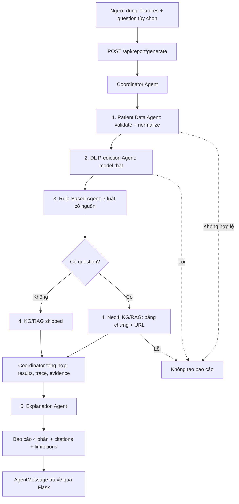

# GIAI ĐOẠN 6 — EXPLANATION AGENT: BÁO CÁO TỔNG HỢP CÓ CĂN CỨ

**Môn:** Phát triển các hệ thống thông minh — PTIT  
**Đề tài:** Hybrid Multiagent System for Diabetes Decision Support  
**Ngày chuẩn bị:** 12/11/2026  
**Điều kiện:** Sinh viên đã xác nhận Giai đoạn 0–5 PASS; Giai đoạn 5 đã kiểm thử **120/120 tests**.  
**Quy tắc dừng:** Chỉ chuyển sang Giai đoạn 7 nếu các kiểm thử bên dưới PASS và sinh viên xác nhận rõ ràng.

> Hệ thống này là sản phẩm học phần. Không dùng để chẩn đoán, kê thuốc, thay đổi điều trị hoặc tự đánh giá sức khỏe cá nhân. Chỉ thử nghiệm bằng dữ liệu tổng hợp, công khai hoặc đã được phép sử dụng và loại bỏ định danh.

## 1. Mục tiêu và căn cứ kiến trúc

Theo **PDF kiến trúc do giảng viên cung cấp**, được lưu tại `docs/references/project_architecture_multiagent_diabet_v1.pdf`:

- **§2–3:** `Explanation Agent` thuộc lớp Intelligent Agent, tạo **báo cáo có căn cứ** từ đầu ra các Agent chuyên biệt. `Coordinator Agent` vẫn là bộ phận điều phối, không thay thế DL/Neo4j.
- **§5.1, §5.3:** thực hiện Patient Data → DL Prediction → Rule-Based → KG/RAG → Coordinator tổng hợp → **Explanation Agent** → Monitoring Agent → phản hồi.
- **§6.3:** Explanation nhận dự đoán, rule results, knowledge evidence; trả về structured explanation.
- **§7.1–7.2:** phân biệt đầu ra mô hình với chứng cứ KG; tài liệu phải truy xuất được nguồn.
- **§9 Phase 6:** triển khai Explanation Agent; bước tiếp theo là giao diện và kiểm thử.
- **§10:** không trình bày dự đoán là chẩn đoán; không kê đơn; tri thức có nguồn; dữ liệu mâu thuẫn cần người có chuyên môn xem xét.

**Lựa chọn kỹ thuật của project (không phải yêu cầu nguyên văn PDF):** sử dụng **template-based explanation** thay vì LLM để code ngắn gọn, tái hiện được, ít phụ thuộc và không bịa ra kiến thức ngoài graph. PDF cho phép LLM **hoặc** template-based. Không cần cài Ollama hoặc các gói mới ở bước này.

**Ranh giới:** Giai đoạn này xây Explanation Agent và endpoint báo cáo; **Monitoring Agent/persistent audit chưa được triển khai**; dự kiến bổ sung bản tối thiểu ở Giai đoạn 8 (cùng đánh giá tích hợp), để không bỏ thành phần mà PDF yêu cầu. `/api/assess` vẫn `HTTP 501`. Ở Giai đoạn 5, `/api/workflow/run` vẫn trả kết quả thô như trước, không thay đổi hợp đồng.

## 2. Sơ đồ tích hợp



Không có lời gọi API giữa các Agent. Tất cả chạy dưới Flask/Python giống Giai đoạn 5.

## 3. Nội dung báo cáo

Báo cáo chỉ được tạo sau khi `Coordinator` hoàn tất quy trình, có 4 phần cố định:

1. **Kết quả mô hình Deep Learning:** nhãn dataset `0/1`, điểm kỹ thuật lớp 1 và phiên bản mô hình; **không biến score thành xác suất mắc bệnh**. Từng con số dựa trên `payload.results.dl_prediction`.
2. **Đối chiếu Rule-Based:** đã chạy 7 luật, các `rule_id`, tiêu đề, mức `review/info`, lý do và trích dẫn nguồn. Không kết luận chẩn đoán chỉ từ ngưỡng tham khảo. Một cờ không được kích hoạt không có nghĩa người dùng khỏe mạnh.
3. **Thông tin Neo4j có nguồn:** lấy **đúng nguyên văn excerpt** được trả từ `evidence` có `agent=kg_rag`, mỗi mục mang `[K1], [K2]...` liên kết đến source URL. Không dùng câu hỏi hoặc câu trả lời tự do làm bằng chứng. Nếu không có question, ghi rõ KG/RAG `skipped`. Nếu không tìm thấy fact, ghi `no_evidence`; không bịa dữ liệu.
4. **Giới hạn:** nhấn mạnh tính chất học thuật, tình trạng hiệu chuẩn model, bộ luật demo, độ phủ nhỏ của graph, không điều trị/kê đơn.

`report.sources` gồm các citation `R1...` (luật) và `K1...` (tri thức); citation nội bộ `Project data contract` không có URL thì **giữ `url = null`** thay vì tạo URL giả.

### Hợp đồng kết quả

```text
AgentMessage
├── request_id          cùng một ID từ Coordinator
├── agent               coordinator
├── status              ok / error
├── payload
│   ├── workflow_status completed / failed / partial
│   ├── results          patient_data, dl_prediction, rule_based, kg_rag, explanation
│   ├── steps            năm bước khi thành công, có duration_ms
│   ├── explanation_status ok / skipped / error
│   ├── monitoring_status not_implemented
│   ├── report_ready     true chỉ khi đủ điều kiện
│   └── report
│       ├── report_kind  educational_evidence_grounded_not_diagnosis
│       ├── generation_method deterministic_template
│       ├── section_order 4 phần
│       ├── sections      prediction, rule_assessment, knowledge, limitations
│       ├── sources       link tham khảo
│       └── text          báo cáo tiếng Việt có thể hiển thị trực tiếp
└── evidence            bằng chứng gốc từ Coordinator (không nhân bản)
```

**Đừng dùng kết quả fixture trong unit test để báo cáo độ chính xác DL.** Kết quả demo thực tế cần dùng model đã huấn luyện và Neo4j đang chạy.

## 4. Tập tin được bổ sung và chỉnh sửa

Gói ZIP này là **bản vá cho project Giai đoạn 5**, không phải project độc lập:

```text
diabetes-multiagent/
├── backend/
│   ├── explanation/
│   │   ├── __init__.py                    [MỚI]
│   │   └── report_builder.py             [MỚI: template và kiểm nguồn]
│   ├── agents/
│   │   └── explanation_agent.py          [MỚI: AgentMessage]
│   ├── coordinator/
│   │   └── coordinator_agent.py          [SỬA: thêm run_with_explanation, giữ run()]
│   ├── api/
│   │   └── routes.py                     [SỬA: /api/report/generate + readiness]
│   ├── scripts/
│   │   └── report_cli.py                 [MỚI: chạy trực tiếp model và Neo4j thật]
│   └── tests/
│       ├── test_explanation_phase6.py    [MỚI: 28 test logic report]
│       ├── test_report_workflow_phase6.py[MỚI: 15 test Coordinator + Explanation]
│       ├── test_explanation_api_phase6.py[MỚI: 17 HTTP tests]
│       ├── test_api.py                   [SỬA: kiểm tra phase mới]
│       ├── test_coordinator_api_phase5.py[SỬA: status Explanation ready]
│       ├── test_patient_data_api_phase3.py[SỬA: phase mới]
│       └── test_rule_based_api_phase4.py [SỬA: phase mới]
├── data/samples/
│   ├── report_with_question.json        [MỚI]
│   ├── report_without_question.json     [MỚI]
│   └── report_invalid.json              [MỚI]
├── docs/
│   ├── GIAI_DOAN_6_HUONG_DAN.md         [MỚI]
│   └── roadmap.md                       [SỬA]
└── README.md                            [SỬA]
```

**Không đụng tới:** `.venv`, `.env`, `models/`, `data/raw`, `config/model_manifest.json`, `data/knowledge/DB_diabet.cypher`, script seed Neo4j, và mã huấn luyện Deep Learning.

## 5. Cập nhật trên máy Windows 11

Project thực tế của bạn nằm ở:

`D:\PTIT\N4-1\PTHTTM\diabetes-multiagent`

1. Dừng Flask cũ bằng `Ctrl+C` trong terminal chạy server.
2. Sao lưu file `backend/api/routes.py` và `backend/coordinator/coordinator_agent.py` nếu từng tự sửa.
3. Giải nén **`diabetes-multiagent-giai-doan-6-cap-nhat.zip` vào thư mục cha** `D:\PTIT\N4-1\PTHTTM`, chọn ghi đè file trùng. Không giải nén vào chính thư mục `diabetes-multiagent` vì ZIP đã chứa thư mục đó.
4. Mở VS Code với folder `D:\PTIT\N4-1\PTHTTM\diabetes-multiagent`.
5. Dùng `.venv` cũ. **Không cần cài thêm thư viện, tạo lại model hay seed Neo4j.**

Kiểm tra các file:

```powershell
Test-Path .\backend\agents\explanation_agent.py
Test-Path .\backend\explanation\report_builder.py
Test-Path .\backend\scripts\report_cli.py
```

Cả ba lệnh phải trả `True`.

## 6. Kiểm thử theo thứ tự, chỉ làm bước kế nếu bước trước PASS

### Bước 1 — 28 kiểm thử logic báo cáo

```powershell
.\.venv\Scripts\python.exe -m unittest discover -s backend/tests -p test_explanation_phase6.py -v
```

**Kỳ vọng:** `Ran 28 tests ... OK`. Có test cho nguồn https, evidence khuyết, không bịa câu trả lời, đầu ra DL sai, Unicode, 4 phần báo cáo và không tạo chẩn đoán.

### Bước 2 — 15 kiểm thử Coordinator kết nối Explanation

```powershell
.\.venv\Scripts\python.exe -m unittest discover -s backend/tests -p test_report_workflow_phase6.py -v
```

**Kỳ vọng:** `Ran 15 tests ... OK`. Test mô phỏng chỉ dùng nhãn `test-fixture-v1`, không phải dự đoán từ model đã train. Đảm bảo có 5 bước trong trace và không tạo report khi upstream lỗi.

### Bước 3 — Kiểm thử hồi quy toàn project

```powershell
.\.venv\Scripts\python.exe -m unittest discover -s backend/tests -v
```

**Kỳ vọng trên máy đã cài Flask và dependencies:**

```text
Ran 180 tests in ...s

OK
```

180 = 120 bài ở Giai đoạn 5 + 28 test Explanation logic + 15 test Report Workflow + 17 test HTTP.

**Kiểm thử đã thực hiện tại nơi tạo mã:** 126/126 tests **không phụ thuộc Flask** đã PASS; không thể thực thi Flask HTTP tests ở đây vì môi trường tạo mã không có Flask. Vì thế toàn bộ **180/180** phải được bạn xác nhận trên Windows.

Các `UserWarning` và `ConvergenceWarning` trong test huấn luyện trên dữ liệu tổng hợp nhỏ có thể xuất hiện và vẫn `OK`. Điều đó không tự xác nhận hiệu năng trên dataset thật.

### Bước 4 — CLI chạy với model DL và Neo4j **thật**

```powershell
.\.venv\Scripts\python.exe backend/scripts/report_cli.py data/samples/report_with_question.json
```

Kiểm tra kết quả JSON:

```text
agent                     coordinator
status                    ok
payload.workflow_status   completed
payload.explanation_status ok
payload.report_ready      true
payload.monitoring_status not_implemented
payload.report.report_kind educational_evidence_grounded_not_diagnosis
payload.report.generation_method deterministic_template
```

`payload.steps` có thứ tự **patient_data → dl_prediction → rule_based → kg_rag → explanation**. Phần `payload.report.sources` phải có các citation tham khảo cho các nguồn đã sử dụng. Giá trị DL thực tế thay đổi tùy model của bạn.

**Thử không có câu hỏi** — Agent KG/RAG phải `skipped` nhưng báo cáo vẫn được tạo và nói rõ không có bằng chứng Neo4j:

```powershell
.\.venv\Scripts\python.exe backend/scripts/report_cli.py data/samples/report_without_question.json
```

**Thử đầu vào sai** — không tạo báo cáo và CLI trả mã thoát 2:

```powershell
.\.venv\Scripts\python.exe backend/scripts/report_cli.py data/samples/report_invalid.json
$LASTEXITCODE
```

Kỳ vọng `status=error`, `error_type=invalid_patient_data`, `report_ready=false`, `report=null`, `$LASTEXITCODE=2`.

### Bước 5 — Khởi động Flask

Terminal 1:

```powershell
.\.venv\Scripts\python.exe backend/app.py
```

Terminal 2:

```powershell
Invoke-RestMethod http://127.0.0.1:5000/api/health | ConvertTo-Json -Depth 8
```

Kỳ vọng `phase: 6-explanation-agent`; trong `integrations`: `patient_data`, `deep_learning`, `neo4j`, `rule_based`, `coordinator`, `explanation` là `ready`. `monitoring` phải là **`not_implemented`**. `explanation: ready` chỉ chứng minh phần template đã được khởi tạo; phải chạy bước API thực tế để nghiệm thu.

### Bước 6 — Gọi API tạo báo cáo và xem tiếng Việt

**Giữ đúng dạng byte UTF-8** như cách bạn đã sửa thành công từ Giai đoạn 2:

```powershell
$raw = Get-Content .\data\samples\report_with_question.json -Raw -Encoding UTF8

$result = Invoke-RestMethod `
  -Uri http://127.0.0.1:5000/api/report/generate `
  -Method Post `
  -ContentType "application/json; charset=utf-8" `
  -Body ([System.Text.Encoding]::UTF8.GetBytes($raw))

$result.status
$result.payload.workflow_status
$result.payload.explanation_status
$result.payload.report_ready
$result.payload.steps | Format-Table agent,status,version,duration_ms
$result.payload.report.text
$result.payload.report.sources | Format-Table citation,origin,title,url -Wrap
```

**Kỳ vọng:** status `ok`, `workflow_status=completed`, `explanation_status=ok`, `report_ready=True`. Báo cáo có **bốn mục tiếng Việt**, không xuất hiện chuỗi lỗi font `Ä`, `Ã`, `á»`. Câu kiến thức và URL phải tương ứng với các fact trả về bởi Neo4j thật. Chỉ những mục có URL nguồn thật mới được gán URL. Không cần sửa lại `app.json.ensure_ascii=True`.

**Trích JSON có cấu trúc:**

```powershell
$result.payload.report.sections.prediction | ConvertTo-Json -Depth 6
$result.payload.report.sections.rule_assessment | ConvertTo-Json -Depth 9
$result.payload.report.sections.knowledge | ConvertTo-Json -Depth 9
$result.payload.report.sections.limitations | ConvertTo-Json -Depth 6
```

### Bước 7 — Kiểm tra không có câu hỏi và dữ liệu sai

**Không có câu hỏi:**

```powershell
$raw = Get-Content .\data\samples\report_without_question.json -Raw -Encoding UTF8
$result = Invoke-RestMethod -Uri http://127.0.0.1:5000/api/report/generate `
  -Method Post -ContentType "application/json; charset=utf-8" `
  -Body ([System.Text.Encoding]::UTF8.GetBytes($raw))
$result.payload.report.sections.knowledge | ConvertTo-Json -Depth 6
```

Kỳ vọng `knowledge_status=skipped`, `facts=[]`, báo cáo vẫn có 4 phần.

**Đầu vào sai:** `Invoke-RestMethod` sẽ ném HTTP exception ở 400, nên dùng `curl.exe`:

```powershell
curl.exe -i -X POST `
  -H "Content-Type: application/json; charset=utf-8" `
  --data-binary "@data/samples/report_invalid.json" `
  http://127.0.0.1:5000/api/report/generate
```

Kỳ vọng **HTTP 400**, `report_ready=false`, `report=null`, có `problems` nêu lỗi dữ liệu; không được giả lập báo cáo khi đầu vào sai.

### Bước 8 — Kiểm tra hồi quy 3 API chính và status

```powershell
Invoke-RestMethod http://127.0.0.1:5000/api/agents/status | ConvertTo-Json -Depth 6
Invoke-RestMethod http://127.0.0.1:5000/api/rules/catalog | Select-Object count
```

Kiểm thử lại `/api/workflow/run`, `/api/predict`, `/api/knowledge/query` bằng các lệnh đã PASS ở Giai đoạn trước. `POST /api/workflow/run` vẫn trả **4 bước và `report_ready=false`** (API gốc chưa bật Explanation); `POST /api/report/generate` mới trả 5 bước và báo cáo. `/api/assess` vẫn HTTP 501, chưa tuyên bố Monitoring đã hoàn thiện.

## 7. Những lỗi thường gặp

| Hiện tượng | Nguyên nhân và cách xử lý |
|---|---|
| `ModuleNotFoundError: No module named 'explanation'` | ZIP giải nén sai vị trí; kiểm tra `backend/explanation/report_builder.py` và khởi động lại Flask |
| `/api/report/generate` trả 404 | Server cũ vẫn đang chạy; dừng bằng Ctrl+C, chạy lại `backend/app.py` |
| HTTP 503, `neo4j_unavailable` | Kiểm tra instance AuraDB, cấu hình `.env`, mạng; thử `neo4j_cli.py check` như Giai đoạn 2 |
| HTTP 503, `model_unavailable` | Kiểm tra file `models/diabetes_mlp_v1.joblib` và model manifest của Giai đoạn 1 |
| HTTP 400, `invalid_patient_data` | Đầu vào không theo schema/thiếu trường hoặc chứa số có dấu phẩy (ví dụ `27,32`) |
| `report_ready=false`, `explanation_status=skipped` | Một Agent upstream lỗi; xem `payload.problems` và `payload.steps`, không cố ép tạo report |
| `invalid_workflow_for_explanation` | Đầu ra tổng hợp hoặc chứng cứ thiếu/sai cấu trúc; kiểm tra trace, nguồn Neo4j và payload Rule trước |
| Tiếng Việt hiển thị thành `Ã`, `Ä` | Dùng body UTF-8 như hướng dẫn, giữ `app.json.ensure_ascii=True`, khởi động lại Flask |
| Dự đoán khác ví dụ | Hoàn toàn bình thường nếu model/dataset/seed khác; dùng kết quả model thực tế, không chép nhãn giả từ unit test |

## 8. Checklist nghiệm thu và điều kiện dừng

- [ ] Cập nhật ZIP vào đúng project Giai đoạn 5, giữ nguyên `.env`, `.venv`, model và Neo4j.
- [ ] **28/28** test Explanation Agent PASS.
- [ ] **15/15** test Coordinator → Explanation PASS.
- [ ] **180/180** unit tests toàn hệ thống PASS.
- [ ] CLI có question trả `report_ready=true`, 5 bước và báo cáo 4 phần có citation thật.
- [ ] CLI không có question vẫn tạo báo cáo, KG/RAG `skipped`; đầu vào sai không tạo báo cáo.
- [ ] Health `phase=6-explanation-agent`, Explanation `ready`, Monitoring `not_implemented`.
- [ ] `POST /api/report/generate` trả báo cáo tiếng Việt và nguồn từ Neo4j thật.
- [ ] `/api/workflow/run`, `/api/predict`, `/api/knowledge/query` vẫn hoạt động.

**Bạn gửi để kiểm tra nghiệm thu:** (1) dòng tổng kết 180 tests; (2) JSON `/api/health`; (3) `payload.steps`, (4) `payload.report.text`, (5) `payload.report.sources`; (6) trạng thái của một request sai. **Không gửi `.env`, mật khẩu Neo4j hoặc thông tin bệnh nhân có thể nhận dạng.**

**Chỉ sau khi bạn xác nhận Giai đoạn 6 PASS**, chúng ta mới bắt đầu **Giai đoạn 7 — xây dựng frontend React/Vite**.
