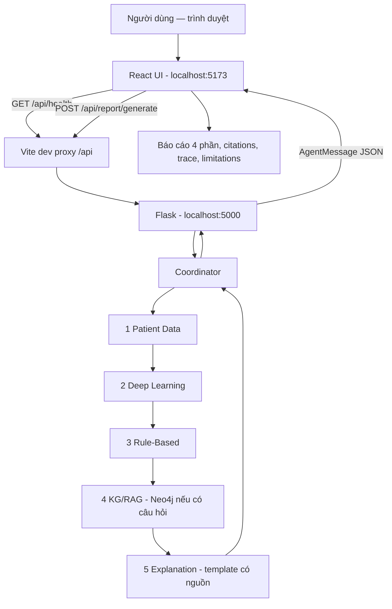

# GIAI ĐOẠN 7 — FRONTEND REACT/VITE

**Project:** Hệ đa Agent hỗ trợ ra quyết định về bệnh tiểu đường  
**Học phần:** Phát triển các hệ thống thông minh — PTIT  
**Trạng thái:** Code đã được bàn giao; **chưa nghiệm thu trên máy người học**.  
**Tiền điều kiện:** Giai đoạn 0–6 đã được người học xác nhận PASS; Giai đoạn 6 có 180 tests và endpoint `/api/report/generate` hoạt động.

> Quy tắc làm việc: chỉ triển khai Giai đoạn 7 ở lượt này. Bạn kiểm tra PASS, gửi kết quả và xác nhận thì mới bắt đầu Giai đoạn 8 (Monitoring/Audit & Evaluation). **Không được hiểu npm test PASS là toàn bộ tích hợp đã PASS** nếu chưa chạy build và thử trong trình duyệt với Backend thật.

## 1. Phạm vi và đối chiếu tài liệu giảng viên

PDF `Hybrid Multiagent System Architecture for Diabetes Decision Support`, §2.1 quy định 6 lớp, trong đó **Layer 1 — User Interaction Layer** cung cấp giao diện người dùng và **Layer 2 — API/Data Processing Layer** nhận request. §5.1 yêu cầu thứ tự Patient Data → DL Prediction → Rule-Based → KG/RAG → Coordinator tổng hợp → Explanation, với Monitoring/Audit ghi metadata trong kiến trúc đầy đủ. §9 Phase 7 là phát triển giao diện; §10 yêu cầu hệ thống là demo học thuật và không trình bày dự đoán như chẩn đoán.

**Triển khai của chúng ta:** React/Vite phía browser cho Layer 1; Flask hiện có là Layer 2; backend Giai đoạn 6 giữ nguyên, API chính là `POST /api/report/generate`. Không gọi thẳng từng Agent từ React: **Coordinator phía Backend** vẫn quyết định thứ tự và tính hợp lệ của kết quả. Chưa xây Monitoring/Audit bền vững ở Phase 7; thành phần đó dành cho Giai đoạn 8. Không đụng tới RL (tùy chọn).

Frontend sử dụng **template UI tĩnh do project tự thiết kế**, không thêm LLM phía trình duyệt, không tự sinh câu trả lời y tế. Các nguồn/đoạn fact hiển thị là dữ liệu Backend thực sự trả về.

## 2. Kiến trúc sau khi tích hợp



Trong **development**, Vite proxy tránh việc phải thay đổi CORS của Flask. Không được đánh đồng proxy ở môi trường development với cấu hình triển khai production. Chưa xây deployment ở Phase 7.

## 3. Các file trong gói ZIP

Gói ZIP là **bản cập nhật** có tiền tố thư mục `diabetes-multiagent/`:

```text
diabetes-multiagent/
├── frontend/
│   ├── .env.example
│   ├── README.md
│   ├── package.json
│   ├── vite.config.js
│   ├── index.html
│   ├── public/favicon.svg
│   ├── src/
│   │   ├── main.jsx
│   │   ├── App.jsx
│   │   ├── styles.css
│   │   ├── components/
│   │   │   ├── FeatureForm.jsx
│   │   │   ├── ReportView.jsx
│   │   │   └── Icon.jsx
│   │   └── lib/
│   │       ├── patient.js    # Schema + kiểm tra đầu vào, không thay thế server
│   │       ├── api.js        # GET health, POST report, xử lý HTTP/timeouts
│   │       └── report.js     # Guard kết quả, lỗi, nhãn Agent và URL nguồn
│   ├── tests/
│   │   ├── patient.test.mjs
│   │   ├── api.test.mjs
│   │   └── report.test.mjs
│   └── scripts/api-smoke.mjs
└── docs/GIAI_DOAN_7_HUONG_DAN.md
```

**Không sửa:** `backend/`, `requirements.txt`, `.venv`, `.env`, model `.joblib`, script Neo4j, `data/raw/`, `config/model_manifest.json`, `frontend/node_modules/` (chưa bao gồm trong ZIP).

## 4. Cài đặt trên Windows 11 bằng VS Code

Project của bạn:

```text
D:\PTIT\N4-1\PTHTTM\diabetes-multiagent
```

**Bước 1 — Giải nén đúng vị trí.** Đóng các terminal đang chạy Vite cũ (nếu có). Giải nén `diabetes-multiagent-giai-doan-7-cap-nhat.zip` vào **thư mục cha**:

```text
D:\PTIT\N4-1\PTHTTM
```

Chọn ghi đè file trùng tên, đặc biệt `frontend/README.md`. Không giải nén trực tiếp vào thư mục `diabetes-multiagent` nếu công cụ giải nén tự tạo thêm `diabetes-multiagent/`.

**Bước 2 — Mở project cũ trong VS Code.** Kiểm tra ba file:

```powershell
Test-Path .\frontend\package.json
Test-Path .\frontend\src\App.jsx
Test-Path .\frontend\vite.config.js
```

Cả ba phải ra `True`.

**Bước 3 — Kiểm tra Node.js.** Vite 7 yêu cầu Node.js ít nhất 20.19 hoặc 22.12. Khuyến nghị dùng Node.js 22 LTS hoặc phiên bản tương thích mới hơn. Kiểm tra:

```powershell
node --version
npm --version
```

**Bước 4 — Cài React/Vite.** Trong thư mục gốc project:

```powershell
cd frontend
npm install
```

Lần cài đầu sẽ tạo `node_modules/` và `package-lock.json`. Gói bàn giao **không chứa `node_modules` hay lockfile**, do môi trường tạo file không truy cập được npm registry. Nếu `npm` bị PowerShell chặn do ExecutionPolicy, dùng `npm.cmd install` thay vì sửa policy toàn máy.

**Bước 5 — Chạy Backend (Terminal 1).** Mở Terminal mới tại **thư mục gốc** project (không ở `frontend`):

```powershell
.\.venv\Scripts\python.exe backend/app.py
```

Backend phải hiển thị cổng `http://127.0.0.1:5000`. Kiểm tra:

```powershell
Invoke-RestMethod http://127.0.0.1:5000/api/health | ConvertTo-Json -Depth 8
```

Kỳ vọng `phase = 6-explanation-agent`; sáu integration `patient_data`, `deep_learning`, `neo4j`, `rule_based`, `coordinator`, `explanation` là `ready`; `monitoring` vẫn `not_implemented`. **Đây là kỳ vọng đúng:** frontend Phase 7 **không** đổi version backend.

**Bước 6 — Chạy Frontend (Terminal 2).** Mở Terminal thứ hai:

```powershell
cd D:\PTIT\N4-1\PTHTTM\diabetes-multiagent\frontend
npm run dev
```

Kỳ vọng hiện địa chỉ `http://127.0.0.1:5173/`. Mở bằng trình duyệt. Không mở `index.html` trực tiếp từ ổ đĩa.

> **Không phải thêm CORS cho Flask.** Vite proxy chuyển đường dẫn `/api/*` tới `http://127.0.0.1:5000/api/*`. Nếu đổi cổng Backend, sửa `target` trong `frontend/vite.config.js`, dừng và chạy lại Vite.

## 5. Tính năng UI và những gì cần quan sát

1. **Trang tổng quan**: tiêu đề project, số thành phần `ready` lấy từ `/api/health`, nút *Kiểm tra kết nối*. Số lượt gửi chỉ tồn tại trong tab hiện tại và không lưu bền vững.
2. **Form 8 đặc trưng**: `gender`, `age`, `hypertension`, `heart_disease`, `smoking_history`, `bmi`, `HbA1c_level`, `blood_glucose_level`. Các lựa chọn/phạm vi đã đối chiếu từ `backend/core/features.py`. Đây là giới hạn kiểm tra kỹ thuật, không phải ngưỡng y khoa.
3. **Nạp mẫu**: điền bộ số liệu mô phỏng giống `data/samples/report_without_question.json`, cộng câu hỏi `Bệnh tiểu đường có mấy loại chính?`. Trình duyệt không tự lưu dữ liệu.
4. **Bật/tắt KG/RAG**: nếu tắt, request **không có thuộc tính** `question` để Coordinator đánh dấu KG/RAG `skipped`. Nếu bật, question phải có nội dung tìm kiếm, 3–500 ký tự.
5. **Tạo báo cáo**: chỉ gửi `{features, question?}` qua `/api/report/generate`. Khi Backend chưa có báo cáo đúng hợp đồng `report_ready=true`, UI hiển thị lỗi, **không vẽ kết quả giả**.
6. **Báo cáo 4 phần**: Nhãn DL và điểm kỹ thuật, rule flags và mức `review/info`, Neo4j fact + citation, các giới hạn. Không biến nhãn thành chẩn đoán.
7. **Nguồn**: tham khảo theo `report.sources` của backend; chỉ tạo link click cho URL `https://`.
8. **Execution Trace**: danh sách 5 Agent trong `payload.steps`, trạng thái, version và `duration_ms`; metadata phản hồi trong lượt chạy, không phải Monitoring/Audit ghi bền vững.
9. **Sao chép báo cáo**: sao chép chính `report.text` từ backend bằng tính năng clipboard của trình duyệt (nếu được phép). Phần *Văn bản báo cáo đầy đủ* và JSON thô có thể mở để đối chiếu.

**Không có:** đăng nhập, bệnh án, lưu phiên, export PDF, tính năng kê đơn, phân quyền bác sĩ, RL hoặc audit DB. Không cần cho Giai đoạn 7 của bài cuối môn.

## 6. Kiểm thử tự động

### 6.1 Test JavaScript độc lập

Ở terminal đang đứng trong `frontend`:

```powershell
npm test
```

**Kết quả mong đợi:**

```text
# tests 36
# pass 36
# fail 0
```

36 test dùng `node:test`, không phụ thuộc npm package ngoài khi thực thi test. Nội dung gồm: hợp đồng 8 đặc trưng, kiểu số và giá trị sai, câu hỏi tùy chọn, loại bỏ trường dư, URL proxy, JSON UTF-8, lỗi HTTP 400/503, timeout, kiểm tra response report và link nguồn HTTPS.

**Đã chạy tại môi trường tạo file:** 36/36 test PASS với Node.js 22.16.0.

### 6.2 Kiểm tra Vite build

```powershell
npm run build
```

Kỳ vọng không có lỗi, tạo folder `frontend/dist/`. Đây là bước **bắt buộc** vì môi trường tạo file không truy cập được npm registry và chưa thể build React/Vite tại đây.

### 6.3 API smoke test (Backend DL + Neo4j thật)

Giữ Flask chạy ở `localhost:5000`. Tại `frontend`:

```powershell
npm run smoke:api
```

Lệnh dùng fixture từ `data/samples/report_with_question.json`, gửi request thật đến Flask và kiểm tra:
- sáu integration `ready`;
- báo cáo 4 phần có `report_ready: true`;
- 5 bước trong `payload.steps`;
- có ít nhất một source Neo4j với URL `https://`;
- hiển thị đúng tiếng Việt.

Kỳ vọng in `REAL API SMOKE PASS`. **Chỉ gọi `npm run smoke:api` khi Backend, mô hình DL và Neo4j đang chạy.** Nếu gặp `ECONNREFUSED`, kiểm tra lại server Python. Nếu thiếu nguồn, kiểm tra Neo4j seed và câu hỏi mẫu.

### 6.4 Hồi quy backend

Ở **thư mục gốc project**, mở terminal Python và chạy:

```powershell
.\.venv\Scripts\python.exe -m unittest discover -s backend/tests -v
```

Kỳ vọng **180/180 tests PASS** (không tăng số test Backend vì chúng ta không sửa Backend).

## 7. Kiểm thử qua trình duyệt — checklist bắt buộc

- **Tình huống A — Có câu hỏi:** mở UI, bấm *Nạp mẫu*, bấm *Tạo báo cáo*. Màn hình phải hiển thị báo cáo, nhãn DL, Rule-Based flags, các đoạn fact Neo4j, citation và 5 Agent steps. Trạng thái từ Backend là hoàn thành.
- **Tình huống B — Không có câu hỏi:** nạp mẫu, tắt *Tra cứu Knowledge Graph*, bấm *Tạo báo cáo*. Báo cáo vẫn tạo, phần tri thức ghi `skipped`, không bịa fact.
- **Tình huống C — Dữ liệu sai:** nạp mẫu rồi thay `BMI = 27,32`. UI phải báo lỗi trước khi gửi. Sửa lại `27.32` thì tiếp tục chạy được.
- **Tình huống D — Thiếu đặc trưng:** xóa `age`. Form phải báo lỗi, không gửi báo cáo rỗng.
- **Tình huống E — Backend ngừng hoạt động:** dừng Flask, bấm *Kiểm tra kết nối*. UI báo chưa kết nối. Bấm tạo báo cáo sẽ có thông báo lỗi mạng, không hiển thị báo cáo cũ như mới thành công.
- **Tình huống F — Responsive:** kiểm tra desktop và chế độ thu nhỏ cửa sổ trình duyệt. Form/trích dẫn/trace không chồng lấn khó đọc; cuộn trang được.
- **Tình huống G — Unicode:** báo cáo hiển thị tiếng Việt bình thường, không có chuỗi mojibake dạng `ÄÆ°`, `tháo`.
- **Tình huống H — Tính riêng tư:** reload tab, dữ liệu đầu vào không tự phục hồi. Không gửi URL chứa dữ liệu bệnh nhân; chỉ thử với dữ liệu mô phỏng.

## 8. Hợp đồng JSON với Backend

**POST** `/api/report/generate`, ví dụ:

```json
{
  "features": {
    "gender": "Female",
    "age": 44,
    "hypertension": 0,
    "heart_disease": 0,
    "smoking_history": "never",
    "bmi": 27.32,
    "HbA1c_level": 5.7,
    "blood_glucose_level": 140
  },
  "question": "Bệnh tiểu đường có mấy loại chính?"
}
```

Những thông tin cốt lõi cần lấy từ response:

```text
agent == coordinator
status == ok
payload.workflow_status == completed
payload.report_ready == true
payload.report.sections.prediction
payload.report.sections.rule_assessment
payload.report.sections.knowledge
payload.report.sections.limitations
payload.report.sources
payload.report.text
payload.steps[0..4]
```

Với input không hợp lệ, Backend có thể trả `HTTP 400` và `payload.problems[].issues` theo trường. Với model hoặc Neo4j không sẵn sàng, Backend trả `HTTP 503`. UI phải hiển thị lỗi, không giả số liệu.

## 9. Các lỗi thường gặp

| Triệu chứng | Cách kiểm tra và xử lý |
|---|---|
| `npm : cannot be loaded because running scripts is disabled` | Chạy `npm.cmd install` / `npm.cmd run dev`, hoặc dùng PowerShell phiên có policy phù hợp. |
| `npm ERR! engine Unsupported engine` | Kiểm tra `node --version`; nâng Node.js lên bản tương thích Vite 7 (>=20.19 hoặc >=22.12). |
| `Port 5173 is already in use` | Dừng Vite cũ (`Ctrl+C`) hoặc kiểm tra tiến trình đang giữ cổng. |
| UI hiện `Không kết nối được Flask API` | Chạy `backend/app.py` trên cổng 5000; Vite trên 5173; kiểm tra cổng/host trong `vite.config.js`. |
| Trình duyệt nhận HTML thay vì JSON | Vite proxy không chuyển tới Flask, hoặc đang mở sai URL; xem tab Network và cổng của cả hai terminal. |
| `HTTP 503` | DL model hoặc Neo4j chưa `ready`; kiểm tra `GET /api/health` trước. |
| `HTTP 400` | Đầu vào sai schema, dấu phẩy thập phân, thiếu trường hoặc câu hỏi không hợp lệ. |
| Timeout 90 giây | Kiểm tra log Flask, trạng thái model/Neo4j, thử API qua Terminal; không tạo báo cáo giả thay thế. |
| Nút sao chép không hoạt động | Clipboard API phụ thuộc quyền/trình duyệt. Mở văn bản báo cáo đầy đủ rồi copy thủ công. |
| `npm run build` lỗi | Gửi **log đầy đủ**, phiên bản Node/npm; không kết luận frontend PASS. |

## 10. Tiêu chí nghiệm thu — chưa chuyển Giai đoạn 8

Chỉ xác nhận Giai đoạn 7 khi:

1. Giải nén đúng vào project đã có; không làm mất `.venv`, `.env`, model hoặc Neo4j.
2. `npm install` hoàn tất; `npm test` **36 PASS**.
3. `npm run build` **PASS**.
4. `npm run smoke:api` **PASS** với DL + Neo4j thật.
5. Flask health báo 6 thành phần thực sự `ready`; Monitoring vẫn chưa triển khai.
6. Trình duyệt hiển thị báo cáo 4 phần và đầy đủ nguồn/trace/Unicode khi dùng dữ liệu mẫu.
7. Trường hợp không có câu hỏi và input sai hoạt động đúng.
8. Chạy lại Python test **180 PASS** (hồi quy Giai đoạn 0–6).
9. Người dùng gửi kết quả và **xác nhận rõ ràng** để bắt đầu Giai đoạn 8.

### Kết quả cần gửi lại để nghiệm thu

- Dòng tổng kết `npm test`.
- Kết quả `npm run build`.
- Kết quả `npm run smoke:api` (không cần gửi input dữ liệu hoặc thông tin riêng tư).
- Dòng tổng kết `180 Python tests`.
- Một ảnh giao diện sau khi có báo cáo hoặc mô tả các phần hiển thị, cùng thông tin lỗi nếu có.

**Dừng ở Giai đoạn 7.** Giai đoạn 8 dự kiến thêm Monitoring/Audit Agent tối thiểu và kiểm thử/đánh giá tích hợp, **chỉ khi bạn xác nhận**.
