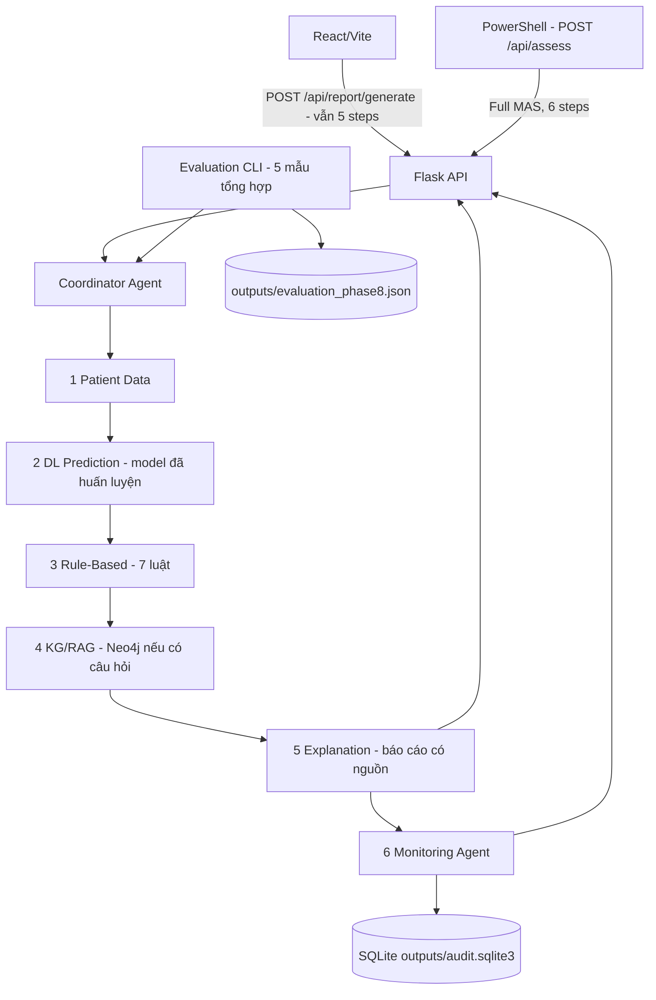

# GIAI ĐOẠN 8 — MONITORING / AUDIT & EVALUATION

**Project:** Hệ đa Agent hỗ trợ ra quyết định về bệnh tiểu đường  
**Học phần:** Phát triển các hệ thống thông minh, PTIT  
**Tiền điều kiện:** Người học đã xác nhận Giai đoạn 0–7 PASS. Giai đoạn 7 có 180 unit tests Backend và 36 tests Frontend PASS trên máy người học.  
**Phạm vi:** Bổ sung Monitoring Agent (SQLite) và bộ đánh giá tích hợp; không thay model DL, Neo4j, bảy luật hoặc giao diện nhập liệu.  
**Quy tắc:** Chỉ triển khai Giai đoạn 8. Sau khi kiểm thử PASS và người học xác nhận mới cân nhắc Giai đoạn 9 (RL trong mô phỏng, *tùy chọn theo PDF*).

> **Lưu ý quan trọng:** Kết quả là minh họa phục vụ học tập, không phải chẩn đoán hay hệ thống lâm sàng. Chỉ dùng dữ liệu tổng hợp hoặc dữ liệu được phép sử dụng. SQLite audit **không lưu thông tin bệnh nhân**, câu hỏi, kết quả dự đoán, nội dung báo cáo hay evidence.

## 1. Đối chiếu tài liệu kiến trúc của giảng viên

Tài liệu `Hybrid Multiagent System Architecture for Diabetes Decision Support` yêu cầu:

- **Layer 6 — Evaluation and Audit**: ghi execution trace, model versions, agent outputs và experimental metrics (mục 2.1). Để giữ dữ liệu tối thiểu, bản triển khai của chúng ta chỉ lưu **metadata của output**, không lưu output y tế gốc. Các output đầy đủ vẫn trả trong **response của một lượt**; không lưu bền vững.
- **Monitoring Agent**: tracking execution, failures, versions and performance (mục 3.1).
- **Workflow**: sau Patient Data → DL Prediction → Rule-Based → KG/RAG → Explanation, Monitoring ghi thông tin thực thi trước khi hệ thống trả kết quả (mục 5.1).
- **AgentMessage**: `request_id`, `agent`, `status`, `payload`, `evidence`, `version` (mục 6).
- **Roadmap**: Phase 8 là testing và evaluation; RL là extension tùy chọn (mục 9, 8).
- **Safety**: không coi kết quả model là chẩn đoán, không kê đơn, phải ghi nguồn KG, RL không ra quyết định cho bệnh nhân (mục 10).

Phạm vi **tự lựa chọn để giảm độ phức tạp bài cuối môn**: SQLite thay vì Elasticsearch/OpenTelemetry; 5 kịch bản tổng hợp để kiểm thử chức năng thay vì benchmark lâm sàng. Không thêm Docker/Kubernetes, microservices, authentication, hệ quản lý hồ sơ, hoặc dịch vụ cloud giám sát.

## 2. Kiến trúc Giai đoạn 8



Phương thức mới `CoordinatorAgent.run_full_with_monitoring()` điều phối đầy đủ sáu Agent cho `/api/assess`; Monitoring được gọi cả khi upstream lỗi để lưu failure metadata. `/api/report/generate` **giữ nguyên 5 bước** vì Frontend cũ đang dựa trên hợp đồng này; sau khi Coordinator kết thúc, API ghi metadata bằng Monitoring và báo `audit_recorded`, không thêm step thứ sáu vào response của route cũ. `/api/workflow/run` vẫn là endpoint demo bốn Agent Giai đoạn 5, *không audit*; không dùng nó để kiểm tra Monitoring Giai đoạn 8.

Nếu SQLite không ghi được:
- `/api/assess` trả **HTTP 503** với `monitoring_status: error` (không giả vờ hoàn thành đủ MAS).
- `/api/report/generate` vẫn giữ kết quả báo cáo đã tạo, nhưng trả `audit_recorded: false` và `monitoring_status: error` để cảnh báo rõ; Frontend hiển thị trạng thái này.

### Dữ liệu được ghi vào SQLite

Bảng `audit_runs`: `request_id`, UTC timestamp, loại route, `status`, `workflow_status`, cờ `report_ready`, cờ có/không câu hỏi, `coordinator_version`, mã `error_type` đã lọc, tổng thời gian thực hiện các Agent.  
Bảng `audit_steps`: `request_id`, số thứ tự, tên Agent, `status`, `version`, `duration_ms`, mã lỗi nếu có.

**KHÔNG ghi:** `features`, BMI/HbA1c/glucose/tuổi/giới tính, câu hỏi, tên người, nhãn dự đoán, score, rule flags, source excerpts, báo cáo, raw error messages, hay password Neo4j. Mã lỗi và phiên bản được lọc chỉ cho phép các machine token đơn giản.

Audit DB là file **cục bộ**. Không đặt nó trên GitHub, không mở endpoint công khai để tra cứu; dùng CLI đọc metadata. Xóa file `.sqlite3` nếu muốn xóa toàn bộ audit trong demo (sau khi dừng Flask). Tham số retention có thể xóa metadata quá hạn bằng CLI.

## 3. Các file mới / cần thay thế

Gói cập nhật có tiền tố thư mục `diabetes-multiagent/`:

```text
diabetes-multiagent/
├── backend/
│   ├── agents/monitoring_agent.py             (mới)
│   ├── monitoring/__init__.py                (mới)
│   ├── monitoring/audit_repository.py        (mới)
│   ├── evaluation/__init__.py                (mới)
│   ├── evaluation/evaluator.py               (mới)
│   ├── coordinator/coordinator_agent.py      (cập nhật)
│   ├── api/routes.py                         (cập nhật)
│   ├── scripts/audit_cli.py                 (mới)
│   ├── scripts/evaluate_phase8.py           (mới)
│   ├── core/registry.py                      (chỉnh ghi chú)
│   └── tests/
│       ├── test_monitoring_phase8.py         (18 tests mới)
│       ├── test_evaluation_phase8.py         (9 tests mới)
│       ├── test_full_coordinator_phase8.py   (3 tests mới)
│       ├── test_monitoring_api_phase8.py     (12 tests mới)
│       └── các test API cũ được cập nhật kỳ vọng của phase 8
├── frontend/src/components/ReportView.jsx    (chỉ cập nhật thông báo audit)
├── data/samples/evaluation_phase8_cases.json (5 scenario tổng hợp)
└── docs/GIAI_DOAN_8_HUONG_DAN.md
```

**Không thay:** `.env`, `.venv`, `models/`, `config/model_manifest.json`, `requirements.txt`, `data/raw/`, Neo4j database, dữ liệu và model đã huấn luyện, `frontend/package.json`, `frontend/node_modules/`, `frontend/src/lib/api.js`, Vite proxy. SQLite dùng thư viện chuẩn `sqlite3` của Python — **không có thư viện Python mới phải cài**. `.gitignore` cũ đã loại trừ nội dung `outputs/`.

## 4. Cập nhật project tại Windows 11 + VS Code

Project hiện tại:

```text
D:\PTIT\N4-1\PTHTTM\diabetes-multiagent
```

1. **Sao lưu project hiện tại** hoặc commit Git trước khi ghi đè, nhất là nếu bạn đã tự sửa `backend/api/routes.py` hoặc `coordinator_agent.py`.
2. Dừng Flask (`Ctrl+C`) và Vite nếu đang chạy.
3. Giải nén ZIP **vào thư mục cha** `D:\PTIT\N4-1\PTHTTM`, cho phép ghi đè file trùng tên. Không giải nén trực tiếp vào trong `diabetes-multiagent` nếu phần mềm giải nén tự tạo thư mục `diabetes-multiagent`.
4. Mở folder project cũ bằng VS Code. Không chép file `.env` khác đè lên `.env` hiện tại.
5. Mở Terminal PowerShell ở thư mục gốc. Xác nhận:

```powershell
Test-Path .\backend\agents\monitoring_agent.py
Test-Path .\backend\monitoring\audit_repository.py
Test-Path .\backend\evaluation\evaluator.py
Test-Path .\data\samples\evaluation_phase8_cases.json
```

Cả bốn phải trả `True`.

**Cấu hình SQLite:** Nếu muốn chỉ rõ vị trí, thêm vào `.env`:

```dotenv
AUDIT_DB_PATH=outputs/audit.sqlite3
```

Không thêm cũng được, vì đây là đường dẫn mặc định. Trên Windows, đường dẫn tương đối được giải quyết dựa trên **thư mục gốc project**, không phụ thuộc Terminal đang đứng ở đâu. SQLite sẽ tự tạo file ở lần đầu khởi tạo/có Health check. Không cài SQLite extension trong VS Code để chạy hệ thống; Python đã có module `sqlite3`.

## 5. Kiểm thử tự động

### Bước 1 — Chỉ kiểm thử logic Monitoring + Evaluation + Coordinator mới

```powershell
.\.venv\Scripts\python.exe -m unittest discover -s backend/tests -p test_monitoring_phase8.py -v
.\.venv\Scripts\python.exe -m unittest discover -s backend/tests -p test_evaluation_phase8.py -v
.\.venv\Scripts\python.exe -m unittest discover -s backend/tests -p test_full_coordinator_phase8.py -v
.\.venv\Scripts\python.exe -m unittest discover -s backend/tests -p test_monitoring_api_phase8.py -v
```

Mong đợi lần lượt **18 + 9 + 3 + 12 = 42 tests PASS**. Các test SQLite dùng file DB tạm, không đụng đến `outputs/audit.sqlite3`. Test API chạy Flask `test_client` với Coordinator giả lập, không cần Neo4j/dataset thật.

### Bước 2 — Toàn bộ Backend

```powershell
.\.venv\Scripts\python.exe -m unittest discover -s backend/tests -v
```

Mong đợi từ bộ project cập nhật: **`Ran 222 tests ... OK`** (180 cũ + 42 mới). Các bài kiểm thử API cũ đã cập nhật kỳ vọng phase và endpoint `/api/assess` mới; kiểm thử các Agent gốc không bị bỏ.

**Trạng thái xác minh tại môi trường tạo ZIP:** 156 kiểm thử Python **không phụ thuộc Flask** PASS (153 test gốc + 3 test Coordinator mới; trong 153 đã gồm 27 test Monitoring và Evaluation); Frontend **36/36 PASS**; syntax Python PASS. Do môi trường tạo file không có Flask/Neo4j chạy thực tế, toàn bộ **222 test** và chạy end-to-end cần bạn xác nhận trên máy Windows. Các warning huấn luyện sklearn giới hạn `max_iter` trong unit test không làm test lỗi; chúng không chứng minh hội tụ của model thật.

### Bước 3 — Kiểm thử Frontend không hồi quy

```powershell
cd frontend
npm test
npm run build
cd ..
```

Kỳ vọng **36/36 JavaScript tests PASS**, `npm run build` thành công; Frontend vẫn gọi `/api/report/generate` và hiển thị 5 Agent. `npm run smoke:api` vẫn kiểm đúng 5 steps (chạy khi Flask/Neo4j đang sẵn sàng).

## 6. Kiểm tra API thật: đủ 6 Agent + SQLite

**Terminal 1:** Tại thư mục gốc, chạy:

```powershell
.\.venv\Scripts\python.exe backend/app.py
```

**Terminal 2:**

```powershell
Invoke-RestMethod http://127.0.0.1:5000/api/health | ConvertTo-Json -Depth 8
```

Kỳ vọng `phase = 8-monitoring-evaluation`; các integration `patient_data`, `deep_learning`, `neo4j`, `rule_based`, `coordinator`, `explanation`, **`monitoring`** đều `ready`. RL vẫn `not_implemented` (theo tài liệu là tùy chọn).

Gọi API mới:

```powershell
$raw = Get-Content .\data\samples\report_with_question.json -Raw -Encoding UTF8
$result = Invoke-RestMethod `
  -Uri http://127.0.0.1:5000/api/assess `
  -Method Post `
  -ContentType "application/json; charset=utf-8" `
  -Body ([System.Text.Encoding]::UTF8.GetBytes($raw))

$result.status
$result.payload.workflow_status
$result.payload.report_ready
$result.payload.monitoring_status
$result.payload.audit_recorded
$result.payload.steps | Format-Table agent,status,version,duration_ms
$result.payload.report.text
```

**Phải có:** `status = ok`, `workflow_status = completed`, `report_ready = True`, `monitoring_status = ok`, `audit_recorded = True`; **6 steps** đúng thứ tự `patient_data → dl_prediction → rule_based → kg_rag → explanation → monitoring`; báo cáo tiếng Việt có nguồn, không khẳng định chẩn đoán.

Lưu ý: mỗi lần nhấn API tạo request ID khác. Không dán thông tin bệnh nhân thật vào chat, nhật ký, hay tài liệu nhóm.

### Kiểm tra SQLite audit metadata

Tại Terminal gốc (không cần dừng Flask):

```powershell
.\.venv\Scripts\python.exe backend/scripts/audit_cli.py summary
.\.venv\Scripts\python.exe backend/scripts/audit_cli.py recent --limit 5
Test-Path .\outputs\audit.sqlite3
```

- `total_runs` tăng sau mỗi lần gọi `/api/assess` hoặc `/api/report/generate` (không tăng khi chỉ gọi `/api/health` hoặc API `/api/workflow/run`).
- `agents` thống kê số lượt `ok/error/skipped`, `avg_duration_ms`, có metadata phiên bản.
- Kết quả `recent` chỉ có ID, thời gian, loại route, trạng thái, phiên bản, latency và mã lỗi. **Không xuất hiện BMI, glucose, HbA1c, question, report text hay source excerpts.**

### Kiểm thử input sai

```powershell
curl.exe -i -X POST `
  -H "Content-Type: application/json; charset=utf-8" `
  --data-binary "@data/samples/workflow_invalid.json" `
  http://127.0.0.1:5000/api/assess
```

Kỳ vọng HTTP 400, lỗi `invalid_patient_data`; `report_ready = false`; `monitoring_status = ok` và `audit_recorded = true` (nếu SQLite còn hoạt động). Điều này chứng minh Monitoring ghi được **thông tin về lỗi**, không làm giả kết quả thành công.

Nếu `outputs/audit.sqlite3` không thể tạo: kiểm tra quyền ghi `outputs/`, `AUDIT_DB_PATH`, chương trình giữ khóa DB. `/api/assess` sẽ không báo PASS giả khi audit thất bại. Trong các môi trường chia sẻ hoặc Internet công khai phải có cơ chế authentication/authorization và chính sách dữ liệu — bản demo không triển khai.

## 7. Evaluation với 5 tình huống tổng hợp

**Quan trọng:** Bộ đánh giá này đo *luồng xử lý chức năng*, **không đo độ chính xác chẩn đoán**.

Khi Neo4j và model sẵn sàng, tại terminal thư mục gốc:

```powershell
.\.venv\Scripts\python.exe backend/scripts/evaluate_phase8.py
```

Script chạy lần lượt qua Coordinator + 5 Agent hiện có (không đi vòng qua Flask), với các case trong `data/samples/evaluation_phase8_cases.json`:

| Case ID | Input mô phỏng | Kết quả mong đợi |
|---|---|---|
| `valid_knowledge` | 8 đặc trưng hợp lệ, có câu hỏi | `ok`, đủ báo cáo, KG `ok` |
| `valid_without_knowledge` | Hợp lệ, không có câu hỏi | `ok`, KG `skipped` |
| `invalid_bmi_format` | `bmi = "27,32"` | `invalid_patient_data`, không tạo báo cáo |
| `invalid_knowledge_question` | câu hỏi `?` | `invalid_question`, không tạo báo cáo |
| `missing_feature` | thiếu `blood_glucose_level` | `invalid_patient_data`, không tạo báo cáo |

Kỳ vọng cuối Terminal:

```text
"total_cases": 5,
"passed": 5,
"failed": 0,
"pass_rate": 1.0
...
EVALUATION PASS
```

File `outputs/evaluation_phase8.json` ghi **chỉ** case ID, kiểm tra PASS/FAIL, mã lỗi kỹ thuật, trạng thái từng Agent và latency; không ghi input hoặc report. Nếu không đủ 5/5, xem `cases` trong file để xác định case nào fail; đừng tự sửa kỳ vọng để ép đạt.

### Đánh giá riêng độ chính xác Deep Learning

Từ Giai đoạn 1, file **`outputs/dl_training_metrics.json`** có `accuracy`, `precision_positive`, `recall_positive`, `f1_positive`, `roc_auc`, `average_precision`, confusion matrix, số hàng train/test. Đây là đánh giá từ tập kiểm tra đã tách khi huấn luyện; **độc lập** với pass rate 5 kịch bản ở trên. Cần đối chiếu kích thước test và class imbalance, không gọi các chỉ số này là kiểm định lâm sàng.

Có thể đưa vào báo cáo môn học bảng gồm: `test_rows`, Accuracy, Precision, Recall, F1, ROC-AUC, thời gian chạy bình quân trong Evaluation; đánh giá 5/5 pass phản ánh logic hoạt động, không phản ánh xác suất bệnh.

## 8. Xem và dọn audit data

Ví dụ chỉ xem 10 bản ghi mới nhất:

```powershell
.\.venv\Scripts\python.exe backend/scripts/audit_cli.py recent --limit 10
```

Dọn bản ghi **cũ hơn 30 ngày** (chỉ khi bạn chủ động muốn xóa dữ liệu, câu lệnh có xác nhận `--yes`):

```powershell
.\.venv\Scripts\python.exe backend/scripts/audit_cli.py purge --older-than-days 30 --yes
```

Muốn xóa toàn bộ lịch sử demo: dừng Flask và các terminal đọc SQLite rồi xóa `outputs/audit.sqlite3` (chỉ với DB demo, không xóa `models/`/Neo4j).

## 9. Không được nhầm PASS kỹ thuật với đánh giá y khoa

- `Ran 222 tests OK`: mã hoạt động và hợp đồng dữ liệu khớp các tình huống test.
- `EVALUATION PASS` 5/5: 5 case tổng hợp được xử lý theo đúng logic.
- `accuracy` trong file training metrics: kết quả phân loại nhãn *của dataset* đã dùng, không khẳng định mô hình được kiểm định cho sử dụng y tế.
- `audit_recorded = true`: metadata đã lưu; không có nghĩa hệ thống an toàn hoặc có quyền xử lý dữ liệu bệnh nhân thật.
- Neo4j fact có source URL: tài liệu truy xuất có xuất xứ, không có nghĩa đây là lời khuyên điều trị cá nhân.

## 10. Checklist nghiệm thu Giai đoạn 8

- [ ] ZIP giải nén đúng vị trí và không mất model, Neo4j, `.env`, frontend trước đó.
- [ ] 42 test mới PASS: Monitoring, Evaluation, Full Coordinator, Monitoring API.
- [ ] Backend toàn bộ 222 unit tests PASS.
- [ ] Frontend 36/36 tests PASS, `npm run build` và `npm run smoke:api` PASS.
- [ ] `/api/health` có `phase=8-monitoring-evaluation`, Monitoring và sáu thành phần cũ `ready`.
- [ ] `/api/assess` trả 6 steps, `audit_recorded=true`, báo cáo tiếng Việt có nguồn.
- [ ] `audit_cli.py summary` đọc được SQLite và không lưu thông tin nhạy cảm.
- [ ] `evaluate_phase8.py` có 5/5 tình huống PASS và tạo file JSON aggregate.
- [ ] API `/api/report/generate` (Frontend cũ), `/api/predict`, `/api/knowledge/query`, `/api/workflow/run` vẫn hoạt động đúng chức năng cũ.

**Bạn gửi lại:** dòng cuối Backend unittest; `npm test`, `npm run build`, `npm run smoke:api`; JSON `/api/health`; bảng `$result.payload.steps` từ `/api/assess`; `audit_cli.py summary`; tổng kết Evaluation 5 cases. Không gửi file `.env`, `audit.sqlite3`, dataset có dữ liệu thật hay full thông tin đầu vào.

**CHƯA làm Giai đoạn 9.** Theo PDF, RL chỉ là phần mở rộng tùy chọn, chạy trong môi trường mô phỏng. Nếu Giai đoạn 8 PASS, có thể xác nhận hệ thống core đủ mục tiêu project cuối môn rồi quyết định có bổ sung mô phỏng RL hay không.
