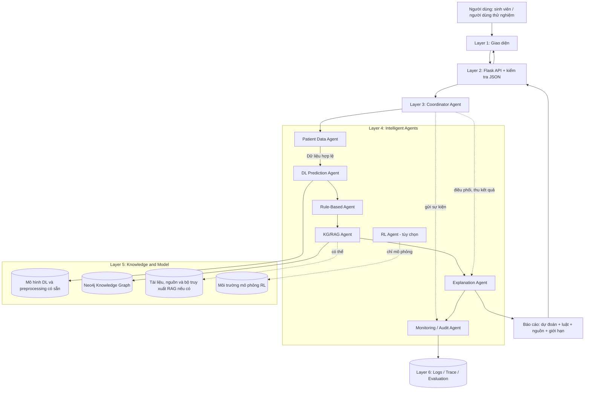
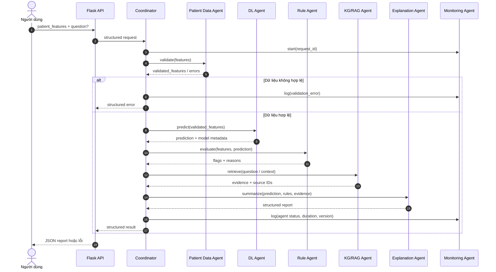

# HỆ ĐA AGENT HỖ TRỢ RA QUYẾT ĐỊNH VỀ BỆNH TIỂU ĐƯỜNG

**Tài liệu thiết kế kiến trúc và hướng dẫn triển khai từ đầu — Bài tập cuối môn Phát triển các hệ thống thông minh (PTIT)**

- **Phiên bản:** 1.0 — 12/11/2026
- **Mục tiêu:** Xây dựng một prototype có thể demo, có kiến trúc đa agent đúng yêu cầu giảng viên, không phải một hệ thống y tế thương mại hay đồ án tốt nghiệp.
- **Phạm vi:** Tích hợp mô hình Deep Learning (DL), Neo4j Knowledge Graph + RAG, Rule-Based Reasoning, điều phối Multi-Agent, giải thích bằng mẫu/LLM, giao diện đơn giản và đánh giá. Reinforcement Learning (RL) là mở rộng tùy chọn.
- **Giới hạn:** Hệ thống phục vụ học tập và hỗ trợ tham khảo, **không phải công cụ chẩn đoán, kê đơn hoặc điều trị đã được kiểm định lâm sàng**.

---

## 1. Nguồn yêu cầu và thứ tự ưu tiên

Đã đối chiếu ba tài liệu do người thực hiện cung cấp:

| Nguồn | Nội dung chính | Cách sử dụng |
|---|---|---|
| `project_architecture_multiagent_diabet_v1.pdf` (11 trang, đặc biệt các mục 2–10) | Kiến trúc 6 tầng; vai trò agent; quy trình phối hợp; giao tiếp; tích hợp DL, Neo4j/RAG; lộ trình và giới hạn an toàn | **Đặc tả chính thức**, ưu tiên khi có khác biệt |
| `multiagent01.png` | Hai nhánh kiến thức: dữ liệu có sẵn → Deep Learning → dự đoán/phân loại; nguồn web/sách → Neo4j KB → RAG/Agent; bổ sung luật, RL và tư vấn | Diễn giải ý tưởng giảng viên ở mức khái quát |
| `multiagent02.png` | Ba cụm: (1) nguồn web/PDF → Neo4j Graph Knowledge, (2) RAG + KB → hỏi đáp, (3) Deep Learning + Agent → kết quả hỗ trợ/tư vấn | Diễn giải luồng dữ liệu, đầu vào và đầu ra của prototype |

**Quy tắc diễn giải:**

1. Giữ đúng các thành phần và vai trò quy định trong PDF; không coi hai hình bảng là sơ đồ tuần tự triển khai chi tiết.
2. Kết nối hai hướng trong hình: **nhánh dữ liệu bệnh nhân → dự đoán bằng DL** và **nhánh tri thức → Neo4j/RAG** bằng **Coordinator Agent + Rule-Based Agent + Explanation Agent**.
3. Hình bảng có nhắc “phân loại”, “TĐ loại 1”; **chỉ được hiển thị loại bệnh nếu mô hình thật được huấn luyện và đánh giá cho nhãn phân loại đó**. Một mô hình phân loại nhị phân không được biến thành bộ phân loại tiểu đường loại 1/loại 2.
4. PDF dùng tên script **`DB_diabet.cypher`**; hình bảng ghi gần giống `kb_diabet.cypher`/`KB_Graph`. Đây là tên/nhãn minh họa có thể khác nhau. Hãy kiểm tra **tên file thực tế** trước khi import; không giả định các file này đã được gửi cùng tài liệu.
5. Dù hình bảng đặt “reinforce learning” dưới Agent, **mục 8 và 9 PDF xác định RL là phần mở rộng tùy chọn, chỉ chạy trong môi trường giả lập**. MVP không cần RL.
6. PDF nói sinh viên **đã có mô hình DL và Knowledge Graph**. Tuy nhiên bộ tài liệu gửi trong lần này chỉ gồm tài liệu kiến trúc và hai sơ đồ, **chưa có file model, pipeline tiền xử lý, dữ liệu huấn luyện hoặc script `.cypher` thực tế**. Những tệp này phải được bổ sung hoặc xác định trạng thái trước khi lập trình tích hợp.

### 1.1. Tách “bắt buộc theo tài liệu” và “đề xuất triển khai”

- **Theo PDF:** 6 tầng; Coordinator; Patient Data Agent; DL Prediction Agent; Rule-Based Agent; KG/RAG Agent; Explanation Agent; Monitoring/Audit Agent; thông điệp có cấu trúc; báo cáo kết hợp prediction/evidence/limitations; tích hợp Neo4j; đánh giá; giới hạn an toàn.
- **Tùy chọn theo PDF:** RL Agent và bộ mô phỏng; kho tài liệu/vector hỗ trợ RAG nếu đã triển khai.
- **Đề xuất để làm gọn:** Flask, React/Vite hoặc giao diện đơn giản khác, thư viện `neo4j`, SQLite lưu trace, Python `unittest`/`pytest`, mẫu sinh báo cáo thay cho LLM ở bản đầu. Đây là **lựa chọn kỹ thuật của tài liệu hướng dẫn**, không phải các công nghệ bắt buộc do PDF chỉ định.

---

## 2. Mục tiêu, phạm vi và sản phẩm tối thiểu (MVP)

### 2.1. Mục tiêu đạt được

Sau khi hoàn thành, người dùng có thể:

1. Nhập bộ đặc trưng của một **ca thử nghiệm giả lập/ẩn danh**, và tùy chọn đặt câu hỏi về kiến thức tiểu đường.
2. Hệ thống kiểm tra dữ liệu, chạy đúng **mô hình DL có sẵn**, trả về dự đoán theo nhãn mà mô hình hỗ trợ.
3. Rule-Based Agent sinh các cờ kiểm tra/đánh giá theo quy tắc đã định nghĩa rõ ràng.
4. KG/RAG Agent truy xuất tri thức từ **Neo4j**, trả về thông tin có nguồn gốc.
5. Explanation Agent tổng hợp **dự đoán + luật + bằng chứng + hạn chế** thành một báo cáo dễ đọc.
6. Monitoring Agent lưu lại request ID, agent đã gọi, thời gian chạy, lỗi và phiên bản để phục vụ demo và đánh giá.

### 2.2. Những gì không cần trong bài cuối môn

- Không cần kiến trúc microservices, message broker, Kubernetes, hệ thống quản trị đa người dùng, phân quyền phức tạp hay triển khai cloud.
- Không cần huấn luyện lại mô hình DL có sẵn nếu mô hình và bộ tiền xử lý chạy được.
- Không cần xây Knowledge Graph y khoa quy mô lớn; chỉ cần đủ tri thức để chứng minh các truy vấn có nguồn.
- Không cần huấn luyện RL, triển khai ứng dụng di động hoặc xây pipeline MLOps hoàn chỉnh.
- Không tự đưa ra chẩn đoán chắc chắn, thuốc, liều dùng hay quyết định điều trị.

### 2.3. “Hoàn thành MVP” được định nghĩa ra sao?

**Một request hợp lệ** thực hiện được:

`UI → API → Coordinator → Data Agent → DL Agent → Rule Agent → KG/RAG Agent → Explanation Agent → Monitoring → API → UI`

Kết quả phải tách bạch: **output mô hình** ≠ **cờ luật** ≠ **bằng chứng từ KG/RAG** ≠ **lời giải thích**. Khi một thành phần lỗi, hệ thống không được bịa ra kết quả.

---

## 3. Kiến trúc tổng thể đúng theo PDF: 6 tầng

| Tầng | Tên trong PDF | Nhiệm vụ | Hiện thực đơn giản đề xuất |
|---|---|---|---|
| 1 | User Interaction Layer | Nhập dữ liệu, câu hỏi; xem kết quả và nguồn | React/Vite hoặc giao diện đơn giản |
| 2 | API and Data Processing Layer | Nhận JSON, kiểm tra cấu trúc request, chuẩn bị đầu vào | Flask API; kiểm tra định dạng JSON tại endpoint |
| 3 | Multiagent Coordination Layer | Gọi đúng agent, điều phối thứ tự, tổng hợp, xử lý lỗi | `CoordinatorAgent` chạy trong cùng backend |
| 4 | Intelligent Agent Layer | Data, DL, Rule, KG/RAG, Explanation, Monitoring; RL tùy chọn | Các class Python độc lập, có interface rõ ràng |
| 5 | Knowledge and Model Layer | Mô hình DL, pipeline preprocess, Neo4j, tài liệu/RAG nếu có | File mô hình + `Neo4j` + nguồn dữ liệu |
| 6 | Evaluation and Audit Layer | Trace, lỗi, phiên bản model/agent, chỉ số đánh giá | SQLite hoặc JSONL logs + script kiểm thử |

### 3.1. Sơ đồ kiến trúc đề xuất (đọc từ trên xuống)



**Lưu ý sơ đồ:** Các đường nối giữa agent minh họa thứ tự logic. Trong mã thực tế, **Coordinator là thành phần gọi từng agent và chuyển dữ liệu**, không yêu cầu agent tự kết nối mạng trực tiếp với nhau. Monitoring được gọi ở các mốc quan trọng và cả đường lỗi, không chỉ cuối luồng.

### 3.2. Hai nhánh xử lý đến từ sơ đồ bảng

**Nhánh A — Dữ liệu và Deep Learning:**

`Dữ liệu thử nghiệm → Patient Data Agent → preprocessing đã dùng khi huấn luyện → DL Prediction Agent → prediction/score/model version`

**Nhánh B — Kho tri thức và RAG:**

`Nguồn web/sách/PDF có xuất xứ → xử lý và kiểm tra nội dung → Neo4j Knowledge Graph → KG/RAG Agent → bằng chứng/citation`

**Điểm hội tụ:** `Coordinator + Rule-Based Agent + Explanation Agent → báo cáo hỗ trợ tham khảo`.

> Chú ý: Một file `.cypher` là **script tạo/nạp dữ liệu**, không phải bản thân máy chủ cơ sở dữ liệu. Neo4j phải chạy và chứa các node/relationship sau khi import thì KG/RAG Agent mới truy vấn được.

---

## 4. Danh sách các Agent và trách nhiệm

PDF liệt kê **8 loại Agent**, trong đó **7 loại dùng cho bản chính** và **RL tùy chọn**. Tất cả có thể là class trong một process Python.

| Agent | Input | Xử lý | Output bắt buộc | Ghi chú |
|---|---|---|---|---|
| **Patient Data Agent** | Raw patient features | Kiểu dữ liệu, giá trị thiếu, miền giá trị, thứ tự feature, chuẩn hóa theo pipeline | `validated_features` hoặc `errors` | Không tự dự đoán |
| **DL Prediction Agent** | Dữ liệu đã xác thực | Gọi mô hình đã huấn luyện | `prediction`, `score` nếu có, `model_version` | Không dùng LLM thay thế mô hình DL |
| **Rule-Based Agent** | Features + prediction | Chạy các luật minh bạch, kiểm tra điều kiện | `rule_results`, `review_flags` | Luật phải có ID và lý do |
| **KG/RAG Agent** | Câu hỏi / truy vấn suy ra từ ngữ cảnh | Tìm entity, truy vấn Neo4j, xếp hạng evidence, gắn nguồn; tìm tài liệu nếu có | `evidence[]`, `sources[]` | Neo4j là thành phần cốt lõi |
| **Coordinator Agent** | User request | Sinh request ID; gọi agent; xử lý lỗi; tập hợp output | `workflow_result` | Không làm thay nhiệm vụ chuyên môn |
| **Explanation Agent** | Prediction + rules + evidence | Tạo báo cáo theo mẫu hoặc LLM có kiểm soát | `structured_report` | Không được bịa chứng cứ |
| **Monitoring/Audit Agent** | Event và execution metadata | Ghi log/traces, phiên bản, thời gian, trạng thái | `audit_record` | Không cần kiến trúc theo dõi phức tạp |
| **RL Agent (tùy chọn)** | Trạng thái mô phỏng | Chọn hành động trong môi trường giả lập | `simulation_action` | Không được quản lý điều trị thật |

### 4.1. Nguyên tắc thiết kế Agent

- **Một trách nhiệm chính/agent.** Tránh class `Agent` làm cả DL, RAG, Rule và trả lời.
- **Input/output có cấu trúc**: JSON/dict/Pydantic model, không chỉ những chuỗi tự do.
- **Test độc lập**: Có thể test Data Agent mà không mở Neo4j, hoặc test Coordinator bằng mock agent.
- **Có căn cứ**: Các cờ luật có `rule_id`; bằng chứng KG có source; kết quả DL có model version.
- **Lỗi phải được phát hiện và thể hiện**: Không chuyển lỗi thành kết quả có vẻ hợp lệ.

### 4.2. Vị trí của LLM

LLM **không phải thành phần bắt buộc ở tất cả các Agent**. Theo PDF, Explanation Agent có thể dùng **LLM hoặc template-based reasoning**. Đề xuất:

- Bản 1: sử dụng template để định dạng báo cáo, ổn định, dễ kiểm tra.
- Bản 2 (nếu còn thời gian): thêm Ollama/LLM nội bộ để diễn đạt tự nhiên từ **dữ liệu cấu trúc đã được agent trả về**; chỉ cho phép diễn giải và không tự bổ sung chẩn đoán/nguồn.
- Không lấy câu trả lời trôi chảy của LLM làm bằng chứng rằng dự đoán của mô hình là đúng.

---

## 5. Thiết kế tích hợp Deep Learning

### 5.1. Không huấn luyện lại nếu đã có mô hình đúng yêu cầu

PDF mục 1 và 7.1 yêu cầu **tái sử dụng mô hình đã huấn luyện**. Đầu tiên phải xác định:

1. File model (`.keras`, `.h5`, `.pt`, `.pth`, ...), framework và cách load.
2. File preprocessing (`scaler`, encoder, imputer, danh sách cột, mapping nhãn...) hoặc đoạn code tương đương.
3. **Danh sách và thứ tự feature** chính xác lúc train.
4. Dataset huấn luyện/kiểm tra và ý nghĩa nhãn đích.
5. Output: nhãn nhị phân, nhiều lớp hay điểm số liên tục; `score` có thực sự là xác suất đã hiệu chỉnh hay không.
6. Metric đã có (accuracy/F1/recall/...); version và giới hạn dữ liệu.

**Quan trọng:** Nếu chưa có model + preprocessing thì không thể kết luận đã tích hợp thành công DL. Cần xin lại/chuyển từ bài trước hoặc xây một baseline riêng và ghi rõ đó là giải pháp thay thế, **không giả vờ đã tái sử dụng mô hình có sẵn**.

### 5.2. Model manifest (metadata)

Tạo `config/model_manifest.json` sau khi kiểm tra model thật. Mẫu khung sau **chưa phải thông số mô hình của bạn**:

```json
{
  "model_name": "diabetes_dl",
  "model_version": "v1",
  "framework": "REPLACE_WITH_ACTUAL_FRAMEWORK",
  "model_path": "REPLACE_WITH_ACTUAL_FILE",
  "preprocess_path": "REPLACE_WITH_ACTUAL_PIPELINE",
  "feature_names_in_order": ["REPLACE_WITH_ACTUAL_FEATURES"],
  "target_labels": {"0": "REPLACE", "1": "REPLACE"},
  "score_semantics": "REPLACE_WITH_ACTUAL_MEANING",
  "training_metrics": {}
}
```

Không đưa `feature_names_in_order` giả định vào code chạy thực tế. Nếu từng làm bộ dữ liệu có `age`, `bmi`, `HbA1c_level`, ... thì **chỉ dùng lại danh sách đó khi file model thực sự đã được train với những trường tương ứng**.

### 5.3. Service và Agent

- `ModelService`: load model và pipeline **một lần lúc khởi động**, cung cấp `predict(validated_features)`.
- `DLPredictionAgent`: gọi `ModelService`, kiểm tra output, gắn version và trạng thái.
- `PatientDataAgent`: kiểm tra dữ liệu và tạo vector đúng thứ tự đầu vào; tránh tiền xử lý hai lần.
- Trường hợp model hỗ trợ **binary prediction**: chỉ trả nhãn nhị phân; không hiển thị “loại 1/loại 2” nếu không có mô hình chuyên biệt được đánh giá cho tác vụ đó.

**Điều kiện hoàn thành:** Chạy 3–5 mẫu kiểm thử qua service cho kết quả giống notebook/script suy luận gốc (trong sai số số học cho phép).

---

## 6. Thiết kế Neo4j Knowledge Graph + RAG

### 6.1. Vai trò theo tài liệu

Theo PDF mục 7.2:

`K = (G_Neo4j, D_RAG)`

- `G_Neo4j`: đồ thị tri thức bệnh tiểu đường trong Neo4j.
- `D_RAG`: bộ tài liệu/text retrieval **nếu đã triển khai**. Không bắt buộc phải có vector database riêng trong MVP.

Quy trình Knowledge Agent nêu trong PDF:

1. Hiểu câu hỏi.
2. Xác định thực thể/chủ đề.
3. Truy vấn đồ thị.
4. Truy xuất tài liệu liên quan (nếu có).
5. Xếp hạng bằng chứng.
6. Gắn nguồn.

### 6.2. Chuẩn bị KG từ nguồn web/sách/PDF (như hình bảng)

Nếu **đã có** `DB_diabet.cypher`, ưu tiên import và dùng lại **schema, dữ liệu thật**, không tự dựng schema khác trước khi xem file. Nếu chưa có script, làm một bộ KG minh họa nhỏ với các kiến thức có nguồn hợp lệ.

Quy trình gọn cho trường hợp chưa có KG:

`Tài liệu được phép sử dụng → chọn đoạn ngắn có nguồn → chuẩn hóa khái niệm/quan hệ → kiểm tra thủ công → tạo script Cypher → import Neo4j → kiểm tra node/relationship → truy vấn thử`

Đối với project cuối môn, có thể xây **khoảng 10–30 khái niệm/quan hệ có ý nghĩa**, miễn có truy vấn thật và ghi nguồn. Con số này là **gợi ý khối lượng demo**, không phải yêu cầu từ PDF. Không tự động coi mọi thông tin web là đáng tin.

Mỗi tri thức cần có đường truy xuất nguồn, ví dụ metadata `source_id`, `title`, `url_or_document`, `section`, `updated_at` nếu biết. Cách lưu cụ thể phụ thuộc schema thực tế.

### 6.3. Kiểm tra graph sau import

Trong Neo4j Browser có thể chạy những truy vấn kiểm tra **không giả định tên label/relationship**:

```cypher
MATCH (n) RETURN count(n) AS total_nodes;
```

```cypher
MATCH ()-[r]->() RETURN count(r) AS total_relationships;
```

```cypher
MATCH (n) RETURN labels(n) AS labels, keys(n) AS properties LIMIT 10;
```

```cypher
MATCH (a)-[r]->(b)
RETURN labels(a) AS from_labels, type(r) AS relation, labels(b) AS to_labels
LIMIT 10;
```

Từ kết quả này mới viết **Cypher tham số hóa theo đúng schema thật**, không hardcode `(:Disease)-[:HAS_SYMPTOM]->(:Symptom)` khi chưa biết graph có các tên đó hay không.

### 6.4. KG/RAG Agent ở mức MVP

- Đầu vào: `query`, và tùy chọn `context` (prediction/rules để ưu tiên chủ đề truy vấn; không suy diễn kết luận lâm sàng).
- Nhận diện các chủ đề cố định trong demo: khái niệm, yếu tố liên quan, kiểm tra/chẩn đoán mang tính kiến thức tổng quát, theo đúng dữ liệu của graph.
- Truy vấn Neo4j bằng parameter; giới hạn số kết quả và timeout.
- Chuyển `records` thành `evidence[]` có nội dung, node/quan hệ, nguồn hoặc dấu hiệu thiếu nguồn.
- Nếu có tài liệu bổ sung: truy xuất text và gộp kết quả; đánh dấu graph/document evidence riêng.
- Không có bằng chứng phù hợp: trả `status = "no_evidence"`, không tự tạo nguồn.

**Không được chỉ đưa dữ liệu vào ChromaDB rồi gọi đó là đã tích hợp Neo4j**. Có thể bổ sung ChromaDB ở mức `D_RAG`, nhưng Neo4j vẫn là phần graph bắt buộc theo đặc tả.

### 6.5. Tách kiến thức và suy luận mô hình

- Neo4j/RAG cung cấp **tri thức tham khảo**; không tự xác nhận người dùng mắc bệnh.
- DL Agent cung cấp **kết quả mô hình**, không tự chứng minh tri thức y học.
- Rule Agent cung cấp **các quy tắc minh bạch**; không thay bác sĩ.
- Explanation Agent phải cho thấy thông tin nào đến từ nguồn nào.

---

## 7. Rule-Based Agent và Explanation Agent

### 7.1. Cách xây Rule-Based Agent gọn nhưng đúng vai trò

Mỗi luật có:

```text
rule_id | description | condition | outcome | rationale | version
```

Các luật minh họa **về chất lượng dữ liệu/kết quả**, không sử dụng ngưỡng lâm sàng chưa được xác minh:

- `R001`: Một feature nằm ngoài miền dữ liệu train đã ghi trong `model_manifest` → thêm cờ `out_of_training_range` và đề nghị xem xét độ tin cậy mô hình.
- `R002`: Model không trả về score mặc dù API đang cố hiển thị xác suất → đặt `score_interpretation_unavailable`; UI không được bịa phần trăm.
- `R003`: Mapping output model sang label không xác định → đánh dấu `unknown_model_label`, cần kiểm tra mô hình.

Các rule ví dụ trên phải được điều chỉnh theo metadata có thật. Nếu thêm luật y khoa, cần nêu nguồn, phiên bản và ghi rõ đây chỉ là minh họa học thuật, chưa được chuyên gia thẩm định cho sử dụng lâm sàng.

### 7.2. Format báo cáo của Explanation Agent

Báo cáo nên có 5 phần cố định:

1. **Thông tin kiểm tra đầu vào:** hợp lệ hay chưa; dữ liệu nào bị thiếu.
2. **Kết quả DL:** label, score (nếu hỗ trợ), tên/version model, cách diễn giải được phép.
3. **Kết quả luật:** danh sách `rule_results` và cờ cần xem xét.
4. **Tri thức tham khảo:** bằng chứng từ Neo4j/RAG và nguồn trích dẫn.
5. **Giới hạn:** kết quả thử nghiệm, không phải chẩn đoán; thông báo thiếu/chưa rõ bằng chứng.

Nếu dùng LLM, chỉ cung cấp nội dung nguồn có căn cứ và yêu cầu LLM **không tạo chỉ số, tài liệu tham khảo hoặc lời khuyên điều trị mới**. Có thể dùng template thuần Python để dễ pass kiểm thử.

---

## 8. Luồng tương tác giữa các Agent

### 8.1. Workflow chuẩn theo mục 5 PDF

1. Người dùng gửi `patient_features` và `question` tùy chọn.
2. API nhận request.
3. Coordinator tạo `request_id` và gọi Data Agent.
4. Input không hợp lệ → dừng, trả lỗi rõ ràng và ghi trace.
5. Input hợp lệ → DL Prediction Agent chạy suy luận.
6. Rule-Based Agent áp dụng quy tắc trên features/prediction.
7. KG/RAG Agent truy xuất bằng chứng từ Neo4j (dựa câu hỏi hoặc truy vấn kiến thức mặc định phù hợp).
8. Coordinator tập hợp output, giữ nguyên provenance.
9. Explanation Agent tạo báo cáo.
10. Monitoring Agent lưu trace/metadata (nên log thêm các mốc và lỗi trước đó).
11. API trả JSON cho giao diện.

### 8.2. Sơ đồ sequence



### 8.3. Các nhánh ngoài MVP (không thay workflow chuẩn)

- **Chỉ hỏi kiến thức:** Có thể phát triển chế độ `knowledge_only` gọi KG/RAG → Explanation, không yêu cầu dữ liệu bệnh nhân. Đây là **mở rộng được đề xuất**, không phải luồng chính 11 bước của PDF.
- **Neo4j bị ngắt:** Trả `kg_status = error`, giải thích thiếu bằng chứng; nếu vẫn có prediction thì tách riêng, không giả vờ RAG đã chạy.
- **Model bị ngắt/không load được:** Trả lỗi model; không cho LLM hoặc luật thế vai DL để tạo nhãn giả.
- **Thiếu nguồn hoặc các kết quả bất đồng:** Gắn cờ `requires_review` và trình bày giới hạn một cách rõ ràng.

---

## 9. Hợp đồng dữ liệu (Communication & Data Contracts)

PDF mục 6 yêu cầu dạng tổng quát:

`m_i = (id, agent, status, payload, evidence, version)`

### 9.1. Thông điệp tiêu chuẩn giữa các Agent

```json
{
  "request_id": "req_example_001",
  "agent": "DLPredictionAgent",
  "status": "ok",
  "payload": {
    "prediction": 1,
    "score": 0.78,
    "score_type": "example_only_not_clinical_probability"
  },
  "evidence": [],
  "version": "diabetes_dl_v1",
  "error": null,
  "duration_ms": 18
}
```

**Chú thích:** `1`, `0.78` và thời gian 18 ms là số minh họa trong bản thiết kế, **không phải kết quả thử nghiệm**, cũng không thể mặc nhiên gọi 0.78 là “78% khả năng mắc bệnh”. `error` và `duration_ms` là hai trường mở rộng tiện cho demo.

Giá trị `status` đề xuất: `ok`, `error`, `skipped`, `no_evidence`. Có thể quy về `ok/error` ở HTTP nhưng phải giữ chi tiết cho agent.

### 9.2. API request

Endpoint đề xuất: `POST /api/analyze`.

```json
{
  "request_id": null,
  "patient_features": {
    "ACTUAL_FEATURE_NAME_1": "ACTUAL_VALUE_1",
    "ACTUAL_FEATURE_NAME_2": "ACTUAL_VALUE_2"
  },
  "question": "Thông tin tổng quan liên quan đến chủ đề này là gì?"
}
```

**Chú thích:** Hai key viết hoa là **placeholder**, phải thay bằng danh sách feature từ model thật mới gửi request hợp lệ. Có thể để API tự sinh `request_id` nếu thiếu.

### 9.3. API response (ví dụ cấu trúc, không phải output có thật)

```json
{
  "request_id": "req_example_001",
  "status": "ok",
  "validation": {"valid": true, "warnings": []},
  "prediction": {
    "label": 1,
    "score": null,
    "model_version": "diabetes_dl_v1",
    "score_interpretation": "not_provided"
  },
  "rules": {
    "rule_results": [],
    "review_flags": []
  },
  "knowledge": {
    "status": "ok",
    "evidence": [
      {
        "source_id": "source_from_real_graph",
        "content": "Content returned from Neo4j goes here",
        "origin": "neo4j"
      }
    ]
  },
  "report": {
    "summary": "To be generated from actual agent outputs",
    "limitations": ["Educational prototype; not a confirmed diagnosis"]
  },
  "trace": {
    "agents_called": [
      "PatientDataAgent",
      "DLPredictionAgent",
      "RuleBasedAgent",
      "KGRAGAgent",
      "ExplanationAgent",
      "MonitoringAgent"
    ]
  }
}
```

Dữ liệu `source_from_real_graph` **phải lấy từ Neo4j**, không hardcode cho bản demo thật. `trace` có thể chỉ trả về request ID và trạng thái từng agent, còn thông tin chi tiết nằm trong SQLite.

### 9.4. Hợp đồng phương thức ở mức Python

```python
class PatientDataAgent:
    def run(self, raw_features: dict) -> dict: ...

class DLPredictionAgent:
    def run(self, validated_features: dict) -> dict: ...

class RuleBasedAgent:
    def run(self, validated_features: dict, prediction: dict) -> dict: ...

class KGRAGAgent:
    def run(self, query: str, context: dict | None = None) -> dict: ...

class ExplanationAgent:
    def run(self, prediction: dict, rules: dict, evidence: dict) -> dict: ...

class MonitoringAgent:
    def log_event(self, request_id: str, event: dict) -> None: ...

class CoordinatorAgent:
    def run(self, request: dict) -> dict: ...
```

Đây là **skeleton giao diện**, chưa phải code hoạt động; triển khai chi tiết sau khi xác định model và schema graph.

---

## 10. Công nghệ và cấu trúc thư mục đề xuất

### 10.1. Stack vừa đủ cho môn học

| Thành phần | Khuyến nghị | Lý do |
|---|---|---|
| Backend/API | Python 3 + Flask | Đơn giản, phù hợp mô hình/model Python |
| Agents | Class Python cùng một backend | Đủ để thể hiện MAS, ít cấu hình |
| DL | TensorFlow/Keras **hoặc** PyTorch, đúng với model đã có | Không đổi framework vô cớ |
| Neo4j | Neo4j local / Neo4j Desktop / instance tương đương | Thành phần bắt buộc theo tài liệu |
| RAG | Neo4j driver + retrieval; bộ tài liệu thêm nếu có | Tránh thêm vector DB khi chưa cần |
| LLM | Template trước; Ollama tùy chọn | Giữ demo ổn định và có thể chạy offline |
| Trace | SQLite (`sqlite3`) hoặc JSONL | Nhẹ và dễ kiểm tra |
| UI | React + Vite hoặc UI gọn | Giảng viên thấy rõ input → agent → output |
| Test | `unittest` hoặc `pytest` | Kiểm tra từng agent và luồng tổng |

### 10.2. Cây thư mục

```text
diabetes-multiagent/
├── README.md
├── requirements.txt
├── .env.example
├── .gitignore
├── config/
│   └── model_manifest.json
├── data/
│   ├── knowledge/
│   │   ├── DB_diabet.cypher          # Chỉ khi đã được cung cấp hoặc tự xây
│   │   └── source_catalog.csv        # Mapping nguồn tri thức, nếu cần
│   └── samples/
│       └── demo_cases.json           # Dữ liệu giả lập/được phép sử dụng
├── models/
│   ├── README.md                     # Hướng dẫn đặt model/preprocessing
│   └── ...                           # File model thật, không bịa tên
├── backend/
│   ├── app.py
│   ├── api/
│   │   └── routes.py
│   ├── core/
│   │   ├── coordinator.py
│   │   ├── contracts.py
│   │   └── errors.py
│   ├── agents/
│   │   ├── patient_data_agent.py
│   │   ├── dl_prediction_agent.py
│   │   ├── rule_based_agent.py
│   │   ├── kg_rag_agent.py
│   │   ├── explanation_agent.py
│   │   └── monitoring_agent.py
│   ├── services/
│   │   ├── model_service.py
│   │   ├── neo4j_service.py
│   │   ├── retrieval_service.py
│   │   └── audit_service.py
│   ├── rules/
│   │   └── ruleset.py
│   └── tests/
│       ├── test_model_service.py
│       ├── test_data_agent.py
│       ├── test_kg_rag_agent.py
│       ├── test_rule_agent.py
│       └── test_integration.py
├── frontend/
│   └── ...                           # Chỉ tạo sau khi API chạy ổn
├── docs/
│   ├── architecture.md
│   ├── model_and_data.md
│   └── demo_results.md
└── outputs/
    └── ...                           # Kết quả test, trace demo
```

> Đây là cấu trúc **gợi ý**, không bắt buộc tạo mọi file ngay từ đầu. Khi triển khai từng giai đoạn mới tạo file tương ứng. Không đặt mật khẩu Neo4j, dữ liệu người bệnh thật hay file nhạy cảm vào GitHub.

### 10.3. Biến môi trường mẫu

```dotenv
FLASK_HOST=127.0.0.1
FLASK_PORT=5000
NEO4J_URI=bolt://127.0.0.1:7687
NEO4J_USER=neo4j
NEO4J_PASSWORD=CHANGE_ME_LOCALLY
NEO4J_DATABASE=neo4j
MODEL_MANIFEST_PATH=config/model_manifest.json
EXPLANATION_MODE=template
AUDIT_DB_PATH=outputs/audit.sqlite3
```

`.env` chứa mật khẩu thực tế phải được bỏ qua bởi `.gitignore`; chỉ commit `.env.example`.

---

## 11. Lộ trình thực hiện từ đầu: từng giai đoạn có điều kiện nghiệm thu

**Cách sắp xếp:** Bám **Phase 1–9 của mục 9 PDF**; thêm **Giai đoạn 0** để chuẩn bị và đặt Monitoring Agent trong phần tích hợp/đánh giá. Không bắt đầu bằng giao diện, vì nếu chưa có model và graph thì giao diện chỉ là demo giả.

### Giai đoạn 0 — Chuẩn bị tài nguyên và khóa yêu cầu

**Mục tiêu:** Biết chính xác đã có gì và thiếu gì, tránh viết code dựa trên giả định.

**Cần làm:**

1. Tạo thư mục project và Git repository.
2. Cài Python và tạo venv; xác định sẽ dùng Flask; mở project bằng VS Code.
3. Kiểm kê tệp: DL model, notebook/script inference, preprocessing, tập feature, nhãn, metric, `DB_diabet.cypher`, dữ liệu nguồn.
4. Xác định môi trường Neo4j có thể chạy trên máy; thử kết nối Browser và Bolt port.
5. Viết `docs/model_and_data.md` xác nhận các thành phần thực có; chỗ thiếu ghi rõ `MISSING`, không điền giả.
6. Chọn tối đa 3 câu hỏi KG và 3 ca đầu vào mẫu cho demo.

**Đầu ra:** Project khởi tạo; danh sách tệp đầu vào đã kiểm kê; bảng feature/model; Neo4j sẵn sàng cài/import.

**Nghiệm thu:** Trả lời được: (a) model nằm ở đâu; (b) preprocessor là gì; (c) dự đoán nhãn gì; (d) graph lấy từ file nào; (e) đã có source/citation chưa.

### Giai đoạn 1 — Tích hợp Deep Learning Model (PDF Phase 1)

**Tệp chính:** `config/model_manifest.json`, `backend/services/model_service.py`, `backend/agents/dl_prediction_agent.py`, `backend/tests/test_model_service.py`.

**Thứ tự:**

1. Chạy lại đúng đoạn inference của model gốc ở notebook/script để ghi 3–5 mẫu **expected output**.
2. Đưa model và preprocessor vào vị trí đọc được (không đổi feature order).
3. Viết `ModelService.load()` và `predict()`; kiểm tra dtype và shape.
4. Viết DL Agent trả message chuẩn (`status`, `payload`, `version`).
5. Test với cùng các ca mẫu; test cả trường hợp model file không tồn tại.

**Nghiệm thu:** DL Agent trả kết quả từ model **thật**, khớp phép suy luận gốc; không dùng câu trả lời giả từ LLM.

### Giai đoạn 2 — Tích hợp Neo4j + KG/RAG (PDF Phase 2)

**Tệp chính:** `data/knowledge/DB_diabet.cypher` (nếu có), `backend/services/neo4j_service.py`, `backend/services/retrieval_service.py`, `backend/agents/kg_rag_agent.py`.

**Thứ tự:**

1. Khởi động Neo4j; đặt mật khẩu nội bộ; kiểm tra kết nối Bolt.
2. Import `DB_diabet.cypher`/file thực tế hoặc xây graph nhỏ từ nguồn có dẫn chứng.
3. Dùng bốn câu `MATCH` ở mục 6.3 để kiểm tra số node, quan hệ, labels và property.
4. Chọn 3 câu hỏi dựa trên **dữ liệu graph đã có**, không dựa trên trí nhớ hoặc kết quả LLM.
5. Viết query Cypher có tham số, quy định timeout và giới hạn kết quả.
6. Viết KG/RAG Agent trả `evidence[]`, `source_id`, `status`.
7. Test 1 câu có kết quả; 1 câu không có kết quả; 1 trường hợp Neo4j ngắt.

**Nghiệm thu:** Có thể chứng minh **dữ liệu trả lời đến từ Neo4j**, truy ra node/quan hệ và nguồn; không trả nguồn bịa.

### Giai đoạn 3 — Patient Data Agent (PDF Phase 3)

**Tệp:** `backend/agents/patient_data_agent.py`, `backend/tests/test_data_agent.py`.

**Thứ tự:**

1. Đọc `feature_names_in_order` từ manifest.
2. Kiểm tra đủ trường, kiểu số/chuỗi/category, giá trị missing, phạm vi dữ liệu hợp lệ theo pipeline/model.
3. Chuyển input sang đúng kiểu và thứ tự feature; chỉ thực hiện bước preprocessing được giao cho agent (tránh nhân đôi).
4. Trả rõ `errors` và `warnings`.
5. Test dữ liệu hợp lệ; thiếu trường; sai kiểu; category không biết; giá trị không hợp lệ.

**Nghiệm thu:** Dữ liệu lỗi không bao giờ đến DL Agent; dữ liệu hợp lệ tạo được input đúng với model.

### Giai đoạn 4 — Rule-Based Agent (PDF Phase 4)

**Tệp:** `backend/rules/ruleset.py`, `backend/agents/rule_based_agent.py`, `backend/tests/test_rule_agent.py`.

**Thứ tự:**

1. Viết danh sách khoảng 3–5 luật có `rule_id`, điều kiện, mô tả và lý do (gợi ý phạm vi demo, không phải số lượng PDF yêu cầu).
2. Ưu tiên luật kiểm tra chất lượng/giới hạn mô hình; không tự dựng ngưỡng điều trị.
3. Đảm bảo mỗi luật sử dụng dữ liệu đầu vào và/hoặc prediction một cách minh bạch.
4. Xuất `rule_results[]`, `review_flags[]`; test mỗi nhánh true/false.

**Nghiệm thu:** Hiển thị được luật nào kích hoạt và tại sao; kết quả có thể lặp lại.

### Giai đoạn 5 — Coordinator + Monitoring (PDF Phase 5; Monitoring theo mục 3/6)

**Tệp:** `backend/core/coordinator.py`, `backend/agents/monitoring_agent.py`, `backend/services/audit_service.py`.

**Thứ tự:**

1. Định nghĩa `AgentMessage` chung cho mọi agent và cách xử lý `ok/error/skipped`.
2. Coordinator tạo request ID rồi chạy **Data → DL → Rule → KG/RAG → Explanation**.
3. Đặt nhánh dừng sớm khi dữ liệu sai; lỗi model không được thành prediction giả.
4. Thêm logging từ đầu request, agent bắt đầu/kết thúc, duration, version, lỗi; không log dữ liệu sức khỏe nhạy cảm nếu không cần.
5. Lưu trace vào SQLite/JSONL; test bằng mock agents trước, rồi nối agent thật.

**Nghiệm thu:** Log cho biết request nào gọi agent nào, thứ tự, trạng thái, thời gian; Coordinator xử lý được lỗi.

### Giai đoạn 6 — Explanation Agent (PDF Phase 6)

**Tệp:** `backend/agents/explanation_agent.py`.

**Thứ tự:**

1. Tạo mẫu kết quả theo 5 mục ở phần 7.2.
2. Gắn `source_id` vào câu/đoạn kiến thức, gắn `model_version` vào phần dự đoán.
3. Nếu thiếu evidence, hiển thị “chưa có bằng chứng từ kho tri thức phù hợp”.
4. Nếu input/model không thành công, không tạo báo cáo mang tính dự đoán.
5. Chỉ thêm LLM khi template ổn định; kiểm thử để ngăn câu trả lời vượt nguồn.

**Nghiệm thu:** Báo cáo **không trộn** dự đoán, luật và bằng chứng; phần giới hạn luôn hiển thị.

### Giai đoạn 7 — API và Frontend (PDF Phase 7)

**Tệp:** `backend/app.py`, `backend/api/routes.py`, `frontend/`.

**API tối thiểu:**

- `GET /api/health` — backend hoạt động.
- `GET /api/agents/status` — danh sách agent, trạng thái load model/Neo4j, version nếu có.
- `POST /api/analyze` — luồng end-to-end theo mục 9.

**Thứ tự:**

1. Kiểm tra API bằng Postman/PowerShell/curl trước; hoàn thành JSON response.
2. Dựng UI chỉ cần: form feature, ô câu hỏi tùy chọn, nút phân tích, khu vực report, trạng thái agent, nguồn.
3. UI lấy field theo schema/manifest, không hardcode các feature giả.
4. Hiển thị rõ loading, validation error, model error, Neo4j error và success.
5. Thêm 2–3 bộ dữ liệu demo **không có thông tin nhận dạng người thật**.

**Nghiệm thu:** Người khác có thể nhập dữ liệu và xem đầy đủ report + evidence + trace ID trên màn hình.

### Giai đoạn 8 — Test và đánh giá (PDF Phase 8)

**Tệp:** `backend/tests/test_integration.py`, `docs/demo_results.md`.

**Thứ tự:**

1. Chạy unit test cho từng agent.
2. Chạy integration test luồng chuẩn và các nhánh lỗi.
3. Đo latency cho DL, Neo4j, từng agent và toàn request bằng đồng hồ đo thực tế.
4. Lưu 5–10 ca demo (gợi ý phạm vi), có input, expected status, actual status, nhận xét.
5. Ghi rõ metric của mô hình DL đã có; **không tự đặt accuracy/F1** nếu chưa tính trên bộ test thích hợp.
6. Ghi ảnh chụp giao diện, graph Neo4j, trace và bảng kiểm thử phục vụ báo cáo môn học.

**Nghiệm thu:** Có bảng pass/fail, bằng chứng kết nối Neo4j thật, model thật, Coordinator thật, nguồn và error handling.

### Giai đoạn 9 — RL Agent (PDF Phase 9, **không bắt buộc**)

Chỉ thực hiện nếu giảng viên trực tiếp yêu cầu hoặc còn nhiều thời gian sau khi MVP ổn định. Mô hình RL phải dùng **dữ liệu/trạng thái giả lập**, ví dụ chọn thứ tự **nội dung giáo dục** được hiển thị trong môi trường mô phỏng. MDP định nghĩa `S, A, P, R, gamma` và có benchmark đơn giản so với rule baseline. Không dùng RL quyết định thuốc hay lịch chăm sóc thật.

**Nghiệm thu (nếu làm):** Có môi trường simulation, policy, reward, so sánh baseline, và khẳng định rõ RL **không tác động đến quyết định y khoa thật**.

---

## 12. Chuẩn bị và chạy môi trường trên Windows 11 (gợi ý)

Các lệnh sau áp dụng sau khi **đã cài Python 3 và có thư mục project**, dành cho Windows PowerShell:

```powershell
mkdir diabetes-multiagent
cd diabetes-multiagent
python -m venv .venv
.\.venv\Scripts\Activate.ps1
python -m pip install --upgrade pip
```

Tạo `requirements.txt` tối thiểu theo nhu cầu thực:

```text
Flask
neo4j
python-dotenv
numpy
```

Thêm `pandas`, `joblib`, `tensorflow` **hoặc** `torch` nếu cần cho model gốc; thêm `requests` nếu frontend Python/API client cần. **Không cài cả TensorFlow và PyTorch chỉ để “đầy đủ”.** Khóa version sau khi xác thực chạy ổn, rồi xuất requirements để có thể chạy lại.

```powershell
pip install -r requirements.txt
```

Thiết lập Neo4j bằng **Neo4j Desktop/local service** (hoặc cách triển khai tương đương); kiểm tra Web UI và Bolt. Chép `.env.example` thành `.env` và điền mật khẩu Neo4j **trên máy cá nhân**, không commit. Sau đó import script thực tế qua Neo4j Browser hoặc công cụ Cypher tương ứng, kiểm tra graph theo mục 6.3.

Khi đã triển khai backend:

```powershell
python -m unittest discover -s backend/tests -v
python backend/app.py
```

Nếu sử dụng React/Vite sau cùng:

```powershell
cd frontend
npm install
npm run dev
```

Các lệnh chạy backend/frontend là **khuôn triển khai dự kiến**, sẽ hoạt động sau khi tạo đúng file/code và cài đầy đủ dependencies ở từng giai đoạn; tài liệu này không tuyên bố project đã có thể chạy ngay.

---

## 13. Ma trận kiểm thử cần có

| ID | Trường hợp | Mong đợi | Thành phần kiểm tra |
|---|---|---|---|
| T01 | Features hợp lệ + có câu hỏi KG phù hợp | `status=ok`, prediction từ DL, evidence từ Neo4j, có report | End-to-end |
| T02 | Thiếu feature bắt buộc | Lỗi validation, không gọi DL | Data + Coordinator |
| T03 | Sai kiểu / category không hợp lệ | Lỗi rõ ràng, không trả prediction | Data Agent |
| T04 | Cùng mẫu chạy inference gốc và DL Agent | Cùng nhãn/score theo sai số chấp nhận | ModelService |
| T05 | Câu hỏi có trong graph | `evidence` thực và nguồn truy được | KG/RAG Agent |
| T06 | Câu hỏi không có trong graph | `no_evidence`, không bịa citation | KG/RAG + Explanation |
| T07 | Neo4j bị ngắt | Có lỗi/flag KG, không báo thành công giả | Coordinator |
| T08 | File DL bị thiếu/không load | `model_error`, không có dự đoán giả | DL + Coordinator |
| T09 | Luật có điều kiện true/false | `rule_id` và kết quả xác định được | Rule-Based Agent |
| T10 | Mỗi request | `request_id`, trace, model version, agent status | Monitoring |
| T11 | Kết quả thiếu chắc chắn/thiếu nguồn | Cảnh báo/giới hạn rõ ràng | Explanation |
| T12 | UI gửi JSON và nhận phản hồi | Hiển thị đúng 5 phần báo cáo, không mất nguồn | Frontend + API |

**Các chỉ số báo cáo gợi ý:** tỷ lệ test pass; thời gian inference; thời gian truy vấn Neo4j; thời gian end-to-end; số evidence thực sự có nguồn; kết quả của mô hình DL theo metric gốc. Không cần chạy benchmark nhiều nghìn request.

---

## 14. Kịch bản demo trước giảng viên

**Demo 1 — Luồng chính:** Nhập một ca thử nghiệm hợp lệ, đặt câu hỏi phù hợp tri thức có trong Neo4j. Trình bày rõ input → Data Agent → DL → Rules → KG/RAG → Explanation → report và `request_id`.

**Demo 2 — Kiến thức có nguồn:** Mở Neo4j Browser, chạy truy vấn liên quan để chứng minh dữ liệu trong report đến từ graph; chỉ rõ nguồn và nội dung evidence. Có thể sử dụng cùng ca của demo 1 để giữ luồng chính.

**Demo 3 — Xử lý lỗi:** Bỏ trống một feature bắt buộc. Hệ thống phải dừng trước DL, trả validation error và vẫn ghi trace. Nếu còn thời gian, trình diễn một câu hỏi không có evidence để cho thấy hệ thống không bịa nguồn.

**Thông điệp khi thuyết trình:** “Mỗi agent có nhiệm vụ độc lập, Coordinator điều phối, dữ liệu dự đoán đến từ mô hình DL, bằng chứng đến từ Neo4j/RAG, luật kiểm tra các điều kiện rõ ràng, Explanation Agent tổng hợp và Monitoring Agent lưu truy vết. Đây là prototype học thuật chứ không phải hệ thống chẩn đoán y tế.”

---

## 15. Checklist hoàn thành và ưu tiên công việc

### 15.1. Checklist bắt buộc trước khi nộp

- [ ] Có model DL thật, biết feature order, preprocess, nhãn output, version.
- [ ] Có Neo4j chạy thật và có node/relationship lấy từ `.cypher`/nguồn hợp lệ.
- [ ] Có Patient Data, DL Prediction, Rule-Based, KG/RAG, Coordinator, Explanation, Monitoring Agent.
- [ ] Có hợp đồng dữ liệu thống nhất, xử lý lỗi minh bạch.
- [ ] Chạy được luồng API end-to-end; UI hiển thị kết quả và nguồn.
- [ ] Có dấu vết mỗi request, log lỗi và tên/phiên bản mô hình.
- [ ] Có test Data Agent, ModelService, KG/RAG, Rule Agent và integration.
- [ ] Có bảng kết quả test và kịch bản demo.
- [ ] Báo cáo không mô tả prediction như chẩn đoán chắc chắn; không kê thuốc, liều lượng.
- [ ] Phân biệt phần đã xây thật với phần tùy chọn/chưa triển khai.

### 15.2. Thứ tự ưu tiên nếu thời gian hạn chế

1. **Bắt buộc trước:** DL thật + Neo4j thật, đúng dữ liệu/nguồn.
2. **Sau đó:** Data Agent + Rule Agent + Coordinator; đảm bảo pipeline hoạt động.
3. **Tiếp theo:** Explanation (template) + Monitoring (SQLite/JSONL).
4. **Cuối cùng:** UI đơn giản + test/demo/báo cáo.
5. **Chỉ thêm khi dư thời gian:** LLM để diễn giải mượt hơn, retrieval tài liệu nâng cao, RL simulation.

### 15.3. Điều cần xác nhận ngay trước khi viết code Giai đoạn 1

Để làm tiếp **từng bước và kiểm tra được kết quả thực tế**, cần xác định bốn tài nguyên:

1. **Model DL có sẵn**: tên file, thư viện, notebook/script inference; có preprocessing kèm không?
2. **Graph có sẵn**: có `DB_diabet.cypher` (hoặc file tên khác) không, hiện có Neo4j chạy chưa?
3. **Input/model output thật**: feature names, thứ tự, label meaning, metrics.
4. **Nguồn graph**: khi truy xuất có thông tin source/citation hay chỉ có các node/relationships?

Nếu bất cứ mục nào **chưa có**, hãy ghi `chưa có` thay vì tự điền dữ liệu giả. Sau đó làm Giai đoạn 0 để chuẩn bị; nếu đã đủ tài nguyên, bắt đầu luôn **Giai đoạn 1: tích hợp DL Model**.

---

## 16. Giới hạn nghiên cứu và an toàn (theo mục 10 PDF)

- Đây là **prototype học thuật**, chưa được thẩm định lâm sàng.
- Không mô tả model output như chẩn đoán xác định.
- Không đưa ra thuốc hoặc liều dùng; RL không đưa ra quyết định điều trị thật.
- Luật mang tính y khoa chỉ được dùng lâm sàng sau khi được chuyên gia có chuyên môn thẩm định; trong project nên giới hạn ở luật minh họa và logic kiểm tra rõ ràng.
- Dữ liệu thử nghiệm chỉ lấy từ nguồn công khai, giả lập hoặc đã ẩn danh đúng cách và có quyền sử dụng.
- KG/RAG phải truy xuất được nguồn; chứng cứ thiếu/mâu thuẫn cần được ghi rõ và yêu cầu con người đánh giá.

---

## 17. Kết luận thiết kế

Kiến trúc phù hợp nhất với ba tài liệu là **Hybrid Multiagent System**: mô hình DL đã huấn luyện cho dự đoán, **Neo4j Knowledge Graph + RAG** cho truy xuất tri thức, **Rule-Based Agent** cho quy tắc minh bạch, **Coordinator** cho điều phối, **Explanation** cho báo cáo căn cứ và **Monitoring** cho kiểm thử/kiểm toán. **RL không thuộc MVP bắt buộc.**

Đối với project cuối môn, cách làm hiệu quả nhất là **một backend Python, các agent tách thành module/class, một Neo4j thực, một model DL thực, API và UI gọn**, cộng với bộ kiểm thử vừa đủ. Thiết kế này giữ đúng cấu trúc quan trọng trong PDF mà không biến bài cuối môn thành đồ án tốt nghiệp.

**Bước thực hiện đầu tiên:** Hoàn thành **Giai đoạn 0**, đặc biệt thu thập **mô hình DL và `DB_diabet.cypher` thực tế**; sau khi biết chính xác đầu vào/đầu ra và schema graph, mới xây từng agent để tránh lập trình lại.
